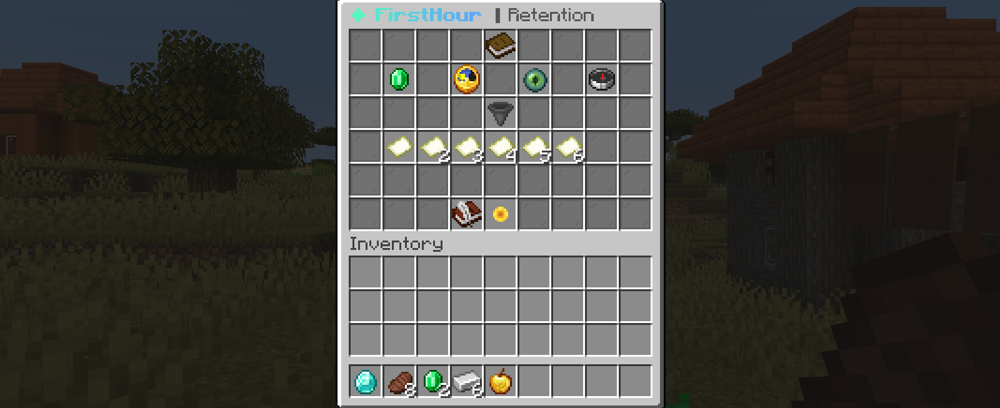

`/firsthour stats` answers the question every owner has: are new players staying, and if not, where do they quit?

It needs `firsthour.admin`. Players opening it get the menu and a chat summary. The console gets the chat summary.

<Frame>
  
</Frame>

## What it shows

Every number covers new players whose first join was in the last 30 days. Veterans don't count.

| Item | What it means | Edition |
| --- | --- | --- |
| **New players** | First joins today, in the last 7 days and in the last 30 days | Lite + PRO |
| **Day-1 return** | Share of new players who joined again 20 to 48 hours after their first join | Lite + PRO |
| **Day-7 return** | Share who joined again 6 to 8 days after their first join | **PRO** |
| **First session** | Median length of a new player's very first visit | **PRO** |
| **Step funnel** | How many started the path, how many finished, and per goal how many reached it and quit there | **PRO** |
| **Export CSV** | Click to write the CSV export | **PRO** |
| **Path** | Click to switch the funnel to the next path. Shows only with more than one path | **PRO** |
| **Refresh** | Click to reload the numbers | Lite + PRO |

On Lite, the PRO items show as locked barriers for admins. Hide them with `pro-hints: false`.

### Fair rates

Rates only count players whose window has closed. Someone who joined an hour ago can't have come back yet, so they don't drag the Day-1 rate down. The lore shows both counts: how many came back, out of how many players whose window has closed. Until anyone's window has closed, the rate reads `n/a`.

| Rate | Counts a player once |
| --- | --- |
| Day-1 | 48 hours have passed since their first join |
| Day-7 | 8 days have passed since their first join |

## The step funnel (PRO)

Each goal on the path gets one item, in order. The stack size is the goal number. The lore shows:

- the step type
- **Reached:** players who got to this goal, and the share of everyone who started
- **Quit here:** players who stopped on this goal

A new player counts as quit when they've been offline for 24 hours without finishing the path. The goal most players quit on turns into a **red** item (`REDSTONE_BLOCK` by default) with the tip "Make it easier or move it later."

The funnel has 14 slots by default. A longer path shows its first 14 goals; add slots under `stats-menu.funnel-steps.slots` to show more. Players who skipped the path stay out of the funnel.

<Tip>
See goal 4 in red? Make it easier, move it later, or give it a better hint. Then check the funnel again next week.
</Tip>

## Chat summary

`/firsthour stats chat` prints the summary without the menu. It's also what the console gets.

```text
✦ FirstHour │ last 30 days
New players: <today> today · <week> this week · <month> this month
Day-1 return: <day1> (<day1_returned>/<day1_settled>)
```

PRO adds Day-7 return, median first session, the path's started and finished counts, and the goal most players quit on. The chat summary always uses the first path in `paths.yml`. The tags in the example above are filled in with your numbers; edit the lines under `stats.chat` in `messages.yml`.

## Cohorts (PRO)

`/firsthour stats cohorts` lists the last 14 join dates in chat, one line each:

```text
Join date · new · Day-1 · Day-7 · finished
```

Dates use the server's time zone. Days with no new players are left out.

## CSV export (PRO)

`/firsthour stats export`, or the **Export CSV** item in the menu, writes one row per join date for the last 30 days to the file below. Days with no new players have no row.

```text
plugins/FirstHour/exports/firsthour-<yyyy-MM-dd-HHmmss>.csv
```

| Column | Meaning |
| --- | --- |
| `date` | First-join date, server time zone |
| `new_players` | New players who first joined that day |
| `day1_settled` | How many of them have a closed Day-1 window |
| `day1_returned` | How many of those came back on Day 1 |
| `day1_rate` | `day1_returned / day1_settled` as a decimal, blank when nothing has settled |
| `day7_settled` | How many have a closed Day-7 window |
| `day7_returned` | How many of those came back on Day 7 |
| `day7_rate` | Decimal, blank when nothing has settled |
| `finished_path` | How many finished their path |
| `median_first_session_seconds` | Median first-session length in seconds, `0` when none have ended |

Open it in any spreadsheet to track retention over time, or to compare before and after a path change.

## Menu layout

Every item's slot and material is in `config.yml` under `stats-menu`. Names and lore are in `messages.yml` under `stats`. See [Stats menu](/firsthour/configuration#stats-menu).

## How the data is stored

FirstHour keeps one row per player in `plugins/FirstHour/players.db` (SQLite). Saves run off the main thread every 10 seconds and when a player leaves. Opening the dashboard saves pending changes first, so the numbers are current.
