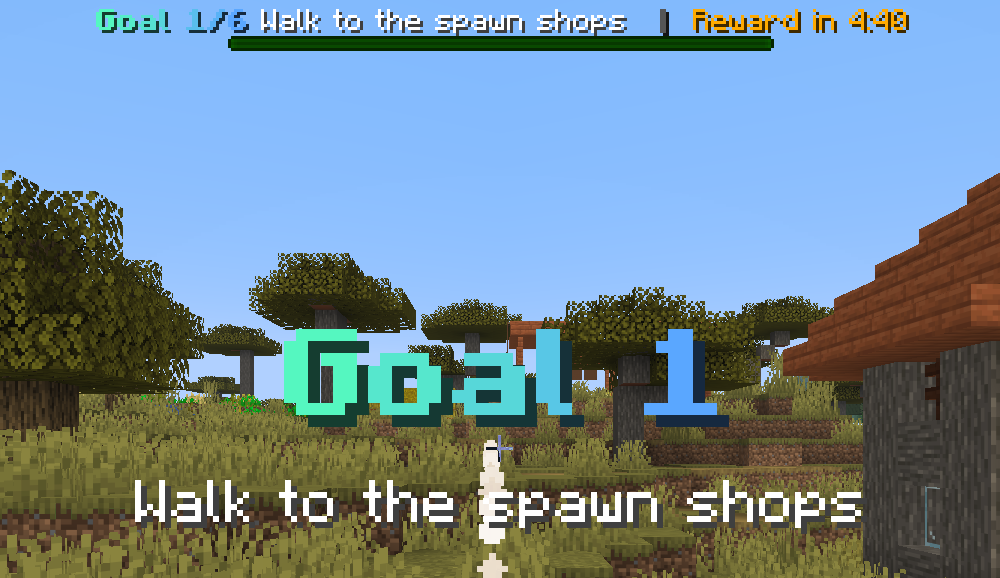

Most new players quit in their first hour. **FirstHour** keeps them, and shows you the numbers.

A new player joins and gets a welcome screen with one **Start** button. Their first goal goes on the bossbar with a live counter and a countdown to the next reward. Every goal pays. Timed rewards drip in while they play. When they finish, they see what tomorrow pays. Then you open `/firsthour stats` and see how many came back and, on PRO, the goal where the rest gave up.

<Frame>
  
</Frame>

## Get FirstHour

<CardGroup cols={2}>
  <Card title="FirstHour PRO" icon="cart-shopping" href="https://builtbybit.com/resources/firsthour-new-player-retention.134624/">
    Unlimited paths and steps, veterans say hi, days 2 to 7, the full dashboard, CSV export and placeholders.
  </Card>
  <Card title="FirstHour Lite (Modrinth)" icon="download" href="https://modrinth.com/plugin/firsthour-lite">
    Free. One path of up to 6 steps, timed rewards, a Day 2 reward and the Day-1 return rate.
  </Card>
  <Card title="FirstHour Lite (SpigotMC)" icon="download" href="https://www.spigotmc.org/resources/140147/">
    The same free Lite jar on SpigotMC.
  </Card>
  <Card title="Discord" icon="discord" href="https://discord.gg/kgHNjJsB2t">
    Support, and your PRO licence key: run `/verify`, then `/claim FIRST_HOUR`.
  </Card>
</CardGroup>

## What it does

- **Welcome screen.** One Start button on the first join. A native dialog on 26.1, a title and a clickable chat line on 1.21.4.
- **One clear goal.** The bossbar shows the current goal, live progress and the time to the next reward.
- **A trail that points the way.** `go_to` goals get a particle line and a compass target.
- **A path for your server.** Write goals in `paths.yml` or load a preset: Survival, or Economy SMP and Lifesteal on PRO.
- **Rewards that keep them playing.** A reward per step, plus timed rewards at 5, 15, 30 and 60 minutes of playtime by default.
- **A reason to come back.** Come-back rewards with a login streak: day 2 on Lite, days 2 to 7 on PRO.
- **Veterans say hi** (PRO). Your regulars get a clickable "say hi" line, and the first to greet a newbie gets paid.
- **The retention dashboard.** New players and Day-1 return on every edition. PRO adds Day-7 return, first-session length, and a step funnel with the goal most players quit on in red.

## Compatibility

- **Server software:** Paper `1.21.4` and `26.1.2`. Spigot and Folia are not supported.
- **Java:** 21 or newer. Paper 26.1 servers need Java 25.
- **Dependencies:** none required. FirstHour runs on a plain Paper server.
- **Optional:** Vault plus an economy plugin (money rewards and `earn` goals), PlaceholderAPI (PRO), Stonkz or Stonkz Lite (PRO), WorldEvents PRO (PRO), Relics SMP (PRO).
- **Storage:** one local SQLite file, `players.db`. No database setup.

## Lite vs PRO at a glance

| Feature | Lite (free) | PRO |
| :-- | :---: | :---: |
| Welcome screen, bossbar goal, trail | ✅ | ✅ |
| Paths | 1 | Unlimited, per permission |
| Steps per path | Up to 6 | Unlimited |
| Presets | Survival | Survival, Economy SMP, Lifesteal |
| Stonkz, WorldEvents PRO and Relics SMP steps | ❌ | ✅ |
| Step rewards and timed rewards | ✅ | ✅ |
| Come-back rewards | Day 2 | Days 2 to 7 |
| Veterans say hi | ❌ | ✅ |
| Dashboard | New players, Day-1 return | Adds Day-7, first session, step funnel |
| CSV export and cohorts | ❌ | ✅ |
| PlaceholderAPI | ❌ | ✅ |

See [Lite vs PRO](/firsthour/lite-vs-pro) for the details.

## Quick commands

```text
/firsthour
/firsthour preset survival
/firsthour stats
/firsthour reload
```

## Documentation sections

<CardGroup cols={2}>
  <Card title="Installation" icon="download" href="/firsthour/installation">
    Drop the jar, add your PRO key, pick a preset.
  </Card>
  <Card title="Lite vs PRO" icon="scale-balanced" href="/firsthour/lite-vs-pro">
    What the free jar does and what PRO adds.
  </Card>
  <Card title="Welcome and goals" icon="flag-checkered" href="/firsthour/welcome-and-goals">
    The first join, the bossbar, the trail and skipping.
  </Card>
  <Card title="Paths and step types" icon="route" href="/firsthour/paths">
    `paths.yml`, the 13 step types and the three presets.
  </Card>
  <Card title="Rewards" icon="gift" href="/firsthour/rewards">
    Step rewards, timed rewards and come-back days.
  </Card>
  <Card title="Veterans say hi" icon="hand" href="/firsthour/veterans">
    Buddy pings and greeting rewards (PRO).
  </Card>
  <Card title="Retention dashboard" icon="chart-line" href="/firsthour/dashboard">
    `/firsthour stats`, the step funnel, cohorts and CSV export.
  </Card>
  <Card title="Commands" icon="terminal" href="/firsthour/commands">
    Every `/firsthour` subcommand.
  </Card>
  <Card title="Permissions" icon="key" href="/firsthour/permissions">
    Four nodes and what they unlock.
  </Card>
  <Card title="Configuration" icon="gear" href="/firsthour/configuration">
    Every `config.yml` key and its default.
  </Card>
  <Card title="Placeholders" icon="tag" href="/firsthour/placeholders">
    `%firsthour_...%` for scoreboards, tab and holograms (PRO).
  </Card>
  <Card title="FAQ" icon="circle-question" href="/firsthour/faq">
    Live servers, Vault, networks, resets and the licence.
  </Card>
</CardGroup>
