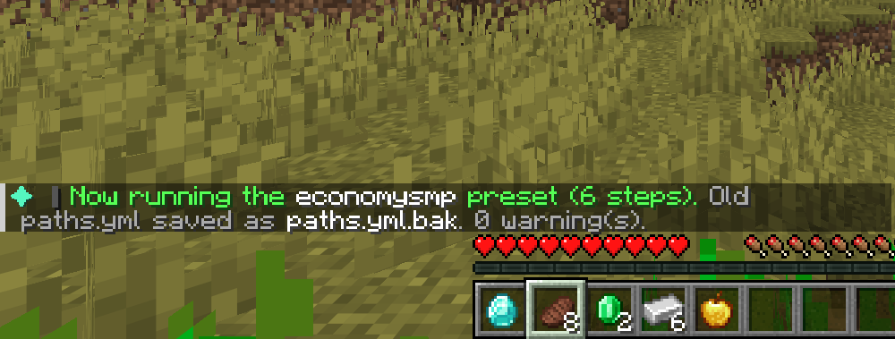

## Requirements

- **Server software:** Paper `1.21.4` or `26.1.2`
- **Java:** 21 or newer. Paper 26.1 servers need Java 25
- **PRO only:** a licence key, and internet access from the server at startup
- **Optional:** Vault plus an economy plugin for money rewards and `earn` goals

FirstHour uses Paper's API. It does not run on Spigot or Folia.

## Pick your jar

| Jar | Where | Licence key |
| --- | --- | --- |
| `FirstHour-Lite-1.0.1.jar` | [Modrinth](https://modrinth.com/plugin/firsthour-lite) or [SpigotMC](https://www.spigotmc.org/resources/140147/) | No |
| `FirstHour-PRO-1.0.1.jar` | [BuiltByBit](https://builtbybit.com/resources/firsthour-new-player-retention.134624/) | Yes |

Run one jar, not both. Both use the same `plugins/FirstHour/` folder, so you can move from Lite to PRO by swapping the jar. Your players, paths and settings stay.

## Install FirstHour Lite

<Steps>
  <Step title="Add the jar">
    Stop the server and put `FirstHour-Lite-1.0.1.jar` in `plugins/`.
  </Step>
  <Step title="Start the server">
    FirstHour writes `plugins/FirstHour/` with `config.yml`, `messages.yml` and a `paths.yml` that holds the Survival preset.
  </Step>
  <Step title="Check the console">
    You should see a line like `FirstHour Lite 1.0.1: 1 path, 6 steps, native dialog.` On 1.21.4 it says `chat welcome` instead.
  </Step>
  <Step title="Join as a new player">
    New players get the welcome screen two seconds after their first join. To test it on your own account, run `/firsthour reset <yourname>` while online.
  </Step>
</Steps>

## Install FirstHour PRO

<Steps>
  <Step title="Add the jar">
    Stop the server and put `FirstHour-PRO-1.0.1.jar` in `plugins/`.
  </Step>
  <Step title="Start once">
    FirstHour writes `plugins/FirstHour/`. Without a key, PRO stops itself and the console asks for one. That is expected on the first start.
  </Step>
  <Step title="Get your licence key">
    Join the [Discord](https://discord.gg/kgHNjJsB2t), run `/verify` to link your purchase, then run `/claim FIRST_HOUR`.
  </Step>
  <Step title="Paste the key">
    Open `plugins/FirstHour/config.yml` and paste the key into `license_key`.
  </Step>
  <Step title="Restart">
    Start the server. The console prints `Licence verified.` and then `FirstHour PRO 1.0.1: ...`.
  </Step>
</Steps>

```yaml title="plugins/FirstHour/config.yml"
# PRO: paste the key from Discord /claim, then restart.
license_key: "YOUR_KEY_HERE"
```

<Warning>
The key is checked when the plugin starts. `/firsthour reload` does not re-check it, so a new key needs a full restart. If the key is empty, still `YOUR_KEY_HERE`, or invalid, FirstHour PRO disables itself.
</Warning>

### How the licence check works

- On startup, FirstHour PRO sends your key to the licence server (`matt-drm.vercel.app`) with a machine ID built from the server's public IP (looked up at `checkip.amazonaws.com`), OS and system user name.
- If the licence server can't be reached, it tries three times in total. After that it starts only if this same key was verified in the last 72 hours. That record lives in `plugins/FirstHour/license-cache.yml` and stores a hash of the key, never the key itself.
- An invalid key never starts, cache or not.

<Card title="Join Discord" icon="discord" href="https://discord.gg/kgHNjJsB2t">
  Run `/verify`, then `/claim FIRST_HOUR` to get your key.
</Card>

## Load a preset

FirstHour starts with the Survival preset. To switch:

```text
/firsthour preset survival
/firsthour preset economysmp
/firsthour preset lifesteal
```

The old `paths.yml` is saved as `paths.yml.bak` first. Economy SMP and Lifesteal are PRO presets. See [Paths and step types](/firsthour/paths).

<Frame>
  
</Frame>

<Note>
The Economy SMP preset has a `go_to` step at `world, 0, 64, 24`. Point it at your spawn shops before you go live.
</Note>

## Adding it to a live server

Players FirstHour has never seen, who already have 30 or more minutes of playtime, count as veterans. They get no path and do not show up as new players in your stats. Change the limit with `new-players.auto-skip-playtime-minutes`. See [Configuration](/firsthour/configuration#new-players).

## Files

| Path | Purpose |
| --- | --- |
| `plugins/FirstHour/config.yml` | Licence key, welcome, bossbar, trail, sounds, titles, stats menu, rewards, buddy pings |
| `plugins/FirstHour/messages.yml` | Every message, in MiniMessage |
| `plugins/FirstHour/paths.yml` | The goals new players follow |
| `plugins/FirstHour/paths.yml.bak` | The previous `paths.yml`, written by `/firsthour preset` |
| `plugins/FirstHour/players.db` | SQLite: one row per player |
| `plugins/FirstHour/exports/` | CSV exports (PRO) |
| `plugins/FirstHour/license-cache.yml` | Last successful licence check (PRO) |

<Warning>
Do not use Bukkit `/reload` or plugin managers to reload FirstHour. Use `/firsthour reload` for config, messages and paths, or restart the server.
</Warning>

## Updates and support

Keep your existing configuration and data when replacing the JAR. Follow [Updating and getting help](/maintenance) for backups, restart checks and the details to include in a support ticket.
