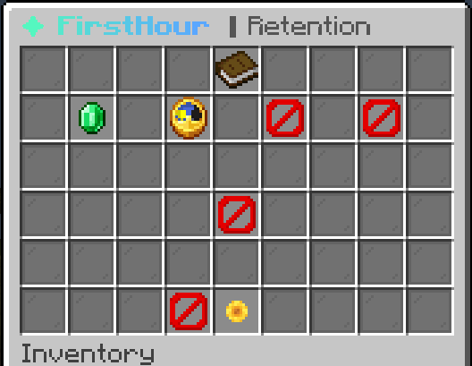

FirstHour comes in two jars. **Lite** is free on Modrinth and SpigotMC. **PRO** is on BuiltByBit and needs a licence key.

Lite is the same plugin with the PRO classes and PRO presets left out of the jar. There is nothing to unlock by editing a config. Lite gets new players started. PRO shows you exactly where the rest quit.

## Feature comparison

| Feature | Lite | PRO |
| :-- | :---: | :---: |
| Welcome screen (native dialog or chat) | ✅ | ✅ |
| Bossbar goal, trail and compass | ✅ | ✅ |
| `/firsthour` status and `/firsthour skip` | ✅ | ✅ |
| Paths | 1 | Unlimited |
| Per-permission paths | ❌ | ✅ |
| Steps per path | Up to 6 | Unlimited |
| Core step types (`command`, `go_to`, `break`, `place`, `craft`, `kill`, `fish`, `earn`, `playtime`, `chat`) | ✅ | ✅ |
| `stonkz_sell`, `we_event_join`, `relic_seen` steps | ❌ | ✅ |
| Presets | Survival | Survival, Economy SMP, Lifesteal |
| Step rewards | ✅ | ✅ |
| Timed rewards | ✅ | ✅ |
| Come-back rewards, with login streak | Day 2 | Days 2 to 7 |
| Veterans say hi (buddy pings) | ❌ | ✅ |
| Stats: new players and Day-1 return | ✅ | ✅ |
| Stats: Day-7 return, median first session, step funnel | ❌ | ✅ |
| `/firsthour stats cohorts` | ❌ | ✅ |
| `/firsthour stats export` (CSV) | ❌ | ✅ |
| PlaceholderAPI placeholders | ❌ | ✅ |
| Licence key | Not needed | Required |

## What Lite does with PRO settings

Lite reads the same `config.yml` and `paths.yml`. It skips what it can't run and says so in the console:

- **Extra paths.** Lite runs the first usable path in `paths.yml`. Each other path logs `Lite runs one path; PRO runs as many as you like`.
- **Steps 7 and up.** Lite runs the first 6 steps of that path. Later steps are left out with a warning.
- **PRO step types.** `stonkz_sell`, `we_event_join` and `relic_seen` steps are skipped with a warning.
- **Path permissions.** Lite ignores `permission:` on a path.
- **Day rewards 3 to 7.** Lite pays the day 2 reward only. The rest stay in your config for when you upgrade.
- **Buddy settings.** The `buddy` section does nothing on Lite.
- **PRO presets.** `/firsthour preset economysmp` and `/firsthour preset lifesteal` reply that it's a PRO feature.

## PRO hints in Lite

On Lite, admins see the PRO-only dashboard items on `/firsthour stats` as locked barrier items with a short description. Players never see them.

<Frame>
  
</Frame>

Turn them off with:

```yaml title="plugins/FirstHour/config.yml"
pro-hints: false
```

`/firsthour pro` lists what PRO adds, with a link to the store page. On PRO it says everything is unlocked.

## Upgrading from Lite to PRO

<Steps>
  <Step title="Buy PRO">
    Get FirstHour PRO on [BuiltByBit](https://builtbybit.com/resources/firsthour-new-player-retention.134624/).
  </Step>
  <Step title="Swap the jar">
    Stop the server, remove `FirstHour-Lite-1.0.1.jar` and add `FirstHour-PRO-1.0.1.jar`.
  </Step>
  <Step title="Add your key">
    In the [Discord](https://discord.gg/kgHNjJsB2t), run `/verify`, then `/claim FIRST_HOUR`. Paste the key into `license_key` in `plugins/FirstHour/config.yml`.
  </Step>
  <Step title="Restart">
    Your `players.db`, `paths.yml` and settings carry over. Paths, steps and day rewards that Lite skipped start working.
  </Step>
</Steps>

<CardGroup cols={2}>
  <Card title="Get FirstHour PRO" icon="cart-shopping" href="https://builtbybit.com/resources/firsthour-new-player-retention.134624/">
    BuiltByBit.
  </Card>
  <Card title="Get FirstHour Lite" icon="download" href="https://modrinth.com/plugin/firsthour-lite">
    Free on Modrinth.
  </Card>
  <Card title="Get FirstHour Lite (SpigotMC)" icon="download" href="https://www.spigotmc.org/resources/140147/">
    Free on SpigotMC.
  </Card>
</CardGroup>
