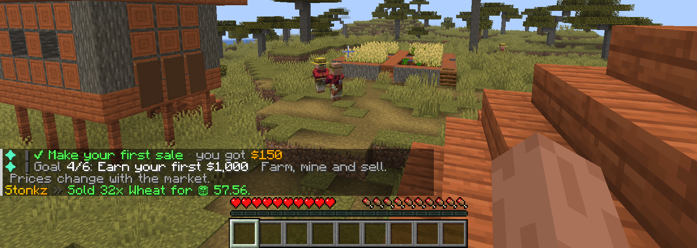

The goals new players follow live in `plugins/FirstHour/paths.yml`. A **path** is an ordered list of **steps**. Each step is one goal with a type, a title, a hint and a reward.

On first start, FirstHour writes the Survival preset as `paths.yml`. Edit it, then run `/firsthour reload`.

## A step

```yaml title="plugins/FirstHour/paths.yml"
paths:
  survival:
    steps:
      wood:
        type: break
        target: [oak_log, spruce_log, birch_log, jungle_log, acacia_log, dark_oak_log, mangrove_log, cherry_log]
        amount: 8
        title: "Chop 8 logs"
        hint: "Punch a tree. Any kind of wood counts."
        reward:
          items: ["APPLE:4"]
```

| Key | Default | What it does |
| --- | --- | --- |
| `type` | required | What the player has to do. See [Step types](#step-types) |
| `target` | any | A list (or one value) of commands, blocks, items or mobs. Leave it out to accept any |
| `amount` | `1` | How many actions, minutes or money the goal needs. Must be above 0 |
| `title` | the step id | What the player reads on the bossbar and in chat. MiniMessage works |
| `hint` | empty | A short tip under the goal. MiniMessage works |
| `reward` | none | What the step pays. See [Rewards](/firsthour/rewards#reward-format) |
| `skip-if-done` | `false` | Count this goal early. See [skip-if-done](#skip-if-done) |
| `location` | `go_to` only | `"world, x, y, z"` |
| `radius` | `6` | `go_to` only. Blocks from the location that count as arrived |

Step ids (`wood` above) use letters, digits, `_` and `-` only. A step pays its reward once per player, keyed by its id, so renaming a step lets it pay again.

## Step types

| Type | Finishes when the player... | `target` | Edition |
| --- | --- | --- | --- |
| `command` | runs one of the target commands | Command names. Required | Lite + PRO |
| `go_to` | reaches `location` within `radius` blocks | none | Lite + PRO |
| `break` | breaks blocks | Block materials, or any block | Lite + PRO |
| `place` | places blocks | Block materials, or any block | Lite + PRO |
| `craft` | crafts items | Item materials, or any item | Lite + PRO |
| `kill` | kills mobs | Entity types (`player` for PvP kills), or any | Lite + PRO |
| `fish` | catches items with a rod | Item materials, or any catch | Lite + PRO |
| `earn` | earns money since the step started | none. Needs Vault and an economy | Lite + PRO |
| `playtime` | reaches minutes played since their first join | none | Lite + PRO |
| `chat` | sends chat messages | none | Lite + PRO |
| `stonkz_sell` | sells with Stonkz | none. Needs Stonkz or Stonkz Lite | **PRO** |
| `we_event_join` | is online when a WorldEvents PRO event starts | Event names, or any event | **PRO** |
| `relic_seen` | runs `/relics` or `/relic`, or picks up a Relics SMP relic | none. Needs Relics SMP | **PRO** |

Type names are case-insensitive, and `go-to` works as well as `go_to`.

### Notes per type

<AccordionGroup>
  <Accordion title="command">
    Write targets with or without the slash. `/essentials:rtp far` counts as `rtp`. Aliases count under the real command name too, so a `rtp` target also finishes when a player types an alias such as `/wild`, as long as the server registers it as an alias of `rtp`. Commands that another plugin cancels do not count.
  </Accordion>
  <Accordion title="go_to">
    `location` is `"world, x, y, z"` using the world's folder name. The check runs every second and measures straight-line distance, including height. The particle trail and compass point at the location. A `go_to` step with a missing or broken location is left out.
  </Accordion>
  <Accordion title="break, place, craft, fish">
    Targets are material names like `oak_log` or `minecraft:oak_log`. A `craft` step counts the items one craft makes. A shift-click craft counts one recipe's output, not the whole stack, so keep `craft` amounts low.
  </Accordion>
  <Accordion title="kill">
    Targets are living entity types like `zombie` or `skeleton`. Use `player` for a PvP goal.
  </Accordion>
  <Accordion title="earn">
    Progress is the player's balance now minus their balance when the step started, checked every second. Spending money lowers it. Without Vault, `earn` steps are left out with a console warning.
  </Accordion>
  <Accordion title="playtime">
    Counts the minutes FirstHour has seen the player online since their first join, not since the step started. A player who already has 10 minutes finishes a 10-minute step the moment they reach it.
  </Accordion>
  <Accordion title="stonkz_sell (PRO)">
    Counts Stonkz's `/sell`, `/sellhand`, `/sellinv`, `/sellinventory` and `/sellall`. A plain `command` step with the same targets also works, which is what the Economy SMP preset does.
  </Accordion>
  <Accordion title="we_event_join (PRO)">
    Every online player on this step gets progress when a WorldEvents PRO event starts. Add event names as targets to count only those events. Target names can't contain spaces.
  </Accordion>
  <Accordion title="relic_seen (PRO)">
    Finishes when the player opens the relic board with `/relics` or `/relic`, or picks up a Relics SMP relic item.
  </Accordion>
</AccordionGroup>

## skip-if-done

Players don't always do things in order. With `skip-if-done: true`, actions that match a later step count toward it before the player gets there. When they reach it, it ticks off at once.

```yaml
      table:
        type: craft
        target: [crafting_table]
        title: "Craft a crafting table"
        skip-if-done: true
```

A player who crafts a table while still chopping logs finishes "Craft a crafting table" the moment the log goal is done. `earn` and `playtime` steps measure a running total, so they only count while they are the current step.

## Several paths (PRO)

PRO runs as many paths as you like. Add `permission:` to a path, and each new player gets the first path in the file they have permission for. A path with no permission is open to everyone.

```yaml
paths:
  vip:
    permission: "server.vip"
    steps:
      # ...
  default:
    steps:
      # ...
```

Put permission paths above the open one. The path is picked once, on the first join. On the PRO stats screen, the **Path** item switches the funnel between paths.

<Note>
Lite runs one path of up to 6 steps and ignores `permission:`. Extra paths and steps stay in the file and start working when you move to PRO.
</Note>

## Presets

```text
/firsthour preset <survival|economysmp|lifesteal>
```

The preset is copied over `paths.yml`, the old file is saved as `paths.yml.bak`, and FirstHour reloads. Each run replaces the previous `.bak`.

<Tabs>
  <Tab title="Survival">
    Lite and PRO. Six steps:

    1. **Chop 8 logs.** `break`: oak, spruce, birch, jungle, acacia, dark oak, mangrove or cherry logs. Reward: 4 apples
    2. **Craft a crafting table.** `craft`, skip-if-done. Reward: 16 torches
    3. **Craft a stone pickaxe.** `craft`, skip-if-done. Reward: 8 coal, 6 bread
    4. **Protect your base.** `command`: `/claim`, `/lands`, `/land`, `/claims`. Skip-if-done. Reward: 4 iron ingots
    5. **Set your first home.** `command`: `/sethome`, `/createhome`. Skip-if-done. Reward: 2 ender pearls
    6. **Defeat a hostile mob.** `kill`: zombie, skeleton, spider, creeper, husk, drowned, stray, enderman, witch. Reward: iron sword, 8 cooked beef
  </Tab>
  <Tab title="Economy SMP">
    **PRO.** Six steps:

    1. **Walk to the spawn shops.** `go_to` at `world, 0, 64, 24`, radius 6. Reward: $50
    2. **Teleport into the wild.** `command`: `/rtp`, `/wild`, `/randomtp`. Skip-if-done. Reward: $100
    3. **Make your first sale.** `command`: `/sell`, `/sellhand`, `/sellinv`, `/sellinventory`, `/sellall`. Skip-if-done. Reward: $150
    4. **Earn your first \$1,000.** `earn`, amount 1000. Reward: \$250, 1 diamond
    5. **Browse the auction house.** `command`: `/ah`, `/auctionhouse`, `/auction`, `/auctions`. Skip-if-done. Reward: $100
    6. **Place your first spawner.** `place`: spawner. Reward: "$500 to grow your farm"

    Set the `go_to` location to your spawn shops before you go live. Money rewards and the `earn` step need Vault.
  </Tab>
  <Tab title="Lifesteal">
    **PRO.** Six steps:

    1. **Gear up: craft a sword.** `craft`: iron, diamond or netherite sword. Skip-if-done. Reward: 5 iron ingots
    2. **Craft a shield.** `craft`. Skip-if-done. Reward: 1 golden apple
    3. **Survive 10 minutes.** `playtime`, amount 10. Reward: 16 cooked beef, 16 arrows
    4. **Find out about the relics.** `relic_seen`. Reward: 2 ender pearls
    5. **Check the event schedule.** `command`: `/wevent`, `/events`, `/worldevents`. Skip-if-done. Reward: 8 bottles o' enchanting
    6. **Take part in a world event.** `we_event_join`. Reward: 2 diamonds

    Without Relics SMP or WorldEvents PRO, steps 4 and 6 are left out and the console says so.
  </Tab>
</Tabs>

<Frame>
  
</Frame>

## Validation

A broken step never stops the plugin. FirstHour leaves it out, keeps the rest of the path, and logs the reason so nobody gets stuck on a goal they can't finish:

- an unknown `type`, or a PRO type on Lite
- a type whose plugin isn't installed (`earn` without Vault, `stonkz_sell` without Stonkz, and so on)
- a `command` step with no target
- a step whose targets are all invalid. Single bad targets are dropped with a warning
- a `go_to` step without a valid `location` and a radius above 0
- a step id with characters other than letters, digits, `_` and `-`

`/firsthour reload` and `/firsthour preset` report the warning count in chat. The details are in the console, each line starting with `paths.yml`.

## Editing a live path

After `/firsthour reload`, FirstHour re-checks every online player, and does the same for others when they next join:

- If a player's path no longer exists, they move to the first path they qualify for and start at goal 1.
- If the path got shorter and they were past the new end, they count as finished.
- Steps they were already paid for don't pay again, as long as the step id stays the same.
