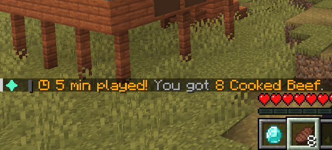
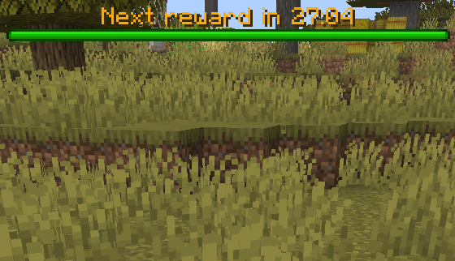

FirstHour pays new players three ways: a reward for each goal, timed rewards while they play, and come-back rewards when they log in on later days. Every reward pays once per player.

## Reward format

Every reward uses the same keys, whether it sits on a step in `paths.yml` or in `config.yml`:

```yaml
reward:
  commands: ["lp user %player% parent add newbie"]
  money: 250
  items: ["GOLDEN_APPLE:1", "DIAMOND:2"]
  label: "$250 and a head start"
```

| Key | What it does |
| --- | --- |
| `commands` | Console commands. `%player%` and `{player}` become the player's name. A leading `/` is dropped |
| `money` | Paid through Vault. Needs Vault and an economy plugin |
| `items` | `"MATERIAL:amount"`. If the inventory is full, the rest drops at the player's feet |
| `label` | What players read. Left out, FirstHour builds it from the money and items, like `$250, 1 Golden Apple, 2 Diamond` |

Bad item entries are skipped with a console warning that shows the expected `DIAMOND:3` shape. A money reward without Vault logs one warning and pays the rest of the reward.

<Note>
A command-only reward has no automatic label. Add a `label` so players see what they got.
</Note>

## Step rewards

Each step in `paths.yml` can have a `reward`. It pays when the goal is done, with a check line in chat:

```text
✔ Make your first sale · you got $150
```

A step pays once per player, ever, keyed by its step id. Rejoining or reloading doesn't pay it again. `/firsthour reset <player>` starts a player over, rewards included.

## Timed rewards

Timed rewards pay at minutes of playtime since a new player's first join. The bossbar counts down to the next one, so there's always something a few minutes away.

```yaml title="plugins/FirstHour/config.yml"
timed-rewards:
  5:
    items: ["COOKED_BEEF:8"]
  15:
    items: ["IRON_INGOT:6"]
  30:
    money: 250
    items: ["GOLDEN_APPLE:1"]
  60:
    money: 500
    items: ["DIAMOND:2"]
```

- Keys are whole minutes above 0. Add, remove or change them freely.
- Playtime is time online as FirstHour counts it, from the first join.
- They keep paying after the path is finished, until the last one.
- Veterans and players who ran `/firsthour skip` don't get them.

<Frame>
  
</Frame>

<Frame>
  
</Frame>

## Come-back days

Day 2 is where servers win or lose new players. Come-back rewards pay when a new player logs in on a later day.

```yaml title="plugins/FirstHour/config.yml"
day-rewards:
  2:
    money: 500
    items: ["DIAMOND:2"]
  3:
    items: ["EXPERIENCE_BOTTLE:16"]
  4:
    money: 750
  5:
    items: ["GOLDEN_APPLE:3"]
  6:
    money: 1000
  7:
    money: 1500
    items: ["DIAMOND:5"]
    label: "$1500 and 5 Diamonds"
```

| | Lite | PRO |
| --- | :---: | :---: |
| Day 2 | ✅ | ✅ |
| Days 3 to 7 | ❌ | ✅ |

### When a day opens

Days count from the first join, with 4 hours of slack so evening players aren't punished:

| Day | Opens after the first join |
| --- | --- |
| 2 | 20 hours |
| 3 | 44 hours |
| 4 | 68 hours |
| 5 | 92 hours |
| 6 | 116 hours |
| 7 | 140 hours |

A day pays when the player joins during it, or within a minute if they're already online when it opens. A missed day is gone. Days outside 2 to 7 are ignored with a warning.

### The reminder

When a player finishes the path, or gets their last timed reward, FirstHour tells them what the next unclaimed day pays:

```text
Day 2 reward: $500, 2 Diamond. Log in tomorrow to claim it.
```

### The streak

The day reward line shows a login streak: the days in a row they've claimed, counting day 1.

```text
Day 3 reward! You got 16 Experience Bottle. Login streak: 3.
```

## Sounds

Each reward moment has its own sound in `config.yml`: `step-done`, `path-complete`, `timed-reward` and `day-reward`. See [Sounds](/firsthour/configuration#sounds).
