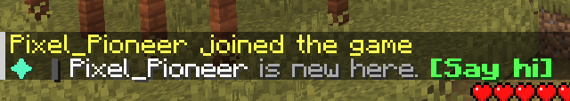
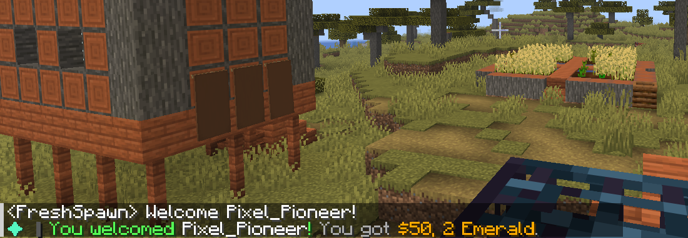

<Note>
Veterans say hi is a **PRO** feature. On Lite, `/firsthour greet` replies that it's a PRO feature.
</Note>

Nothing kills a server faster than an empty chat on day one. When a brand-new player joins, your regulars get one clickable line:

```text
Pixel_Pioneer is new here. [Say hi]
```

The first veteran to greet them gets a small reward, and the new player sees someone welcome them by name.

<Frame>
  
</Frame>

## Who gets pinged

A player gets "say hi" lines when both are true:

- They have `firsthour.veteran` (everyone, by default).
- They aren't a new player still on their own path. Players who finished or skipped their path, and veterans from before FirstHour was added, qualify.

Each veteran gets at most one ping every `ping-cooldown-seconds` (120), however many new players join. The ping plays the `buddy-ping` sound.

## Three ways to greet

1. Click **[Say hi]** in chat.
2. Run `/firsthour greet <player>`.
3. Type the new player's name in chat, like `hi Pixel_Pioneer!`. The name has to stand on its own as a word. Turn this off with `greet-by-chat: false`.

Only the first veteran to greet within `greet-window-seconds` (300) gets the reward. The greeter sees:

```text
You welcomed Pixel_Pioneer! You got $50, 2 Emerald.
```

The new player sees `<greeter> says hi! Welcome to the server.` and hears the `greeted` sound.

<Frame>
  
</Frame>

## Limits

| Limit | Default | What it stops |
| --- | --- | --- |
| `greet-window-seconds` | `300` | Greeting rewards long after the join. Minimum 10 |
| `ping-cooldown-seconds` | `120` | Ping spam when lots of players join |
| `max-rewards-per-hour` | `3` | One veteran farming greet rewards. Counted over a rolling hour |

A veteran past their hourly limit who clicks or uses the command gets a thank-you line instead of a reward. A chat greeting past the limit stays silent. Either way, the new player stays open for someone else to greet.

A new player who is still on their own path can't greet yet. They're told to finish their own goals first.

## Configuration

```yaml title="plugins/FirstHour/config.yml"
buddy:
  enabled: true
  reward:
    money: 50
    items: ["EMERALD:2"]
  greet-window-seconds: 300
  ping-cooldown-seconds: 120
  max-rewards-per-hour: 3
  greet-by-chat: true
```

The `reward` uses the same keys as every other reward: `commands`, `money`, `items` and `label`. See [Reward format](/firsthour/rewards#reward-format).

Set `buddy.enabled: false` to turn buddy pings and greeting rewards off. To keep some players out of it, remove `firsthour.veteran` from them.
