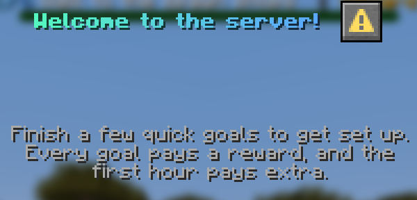
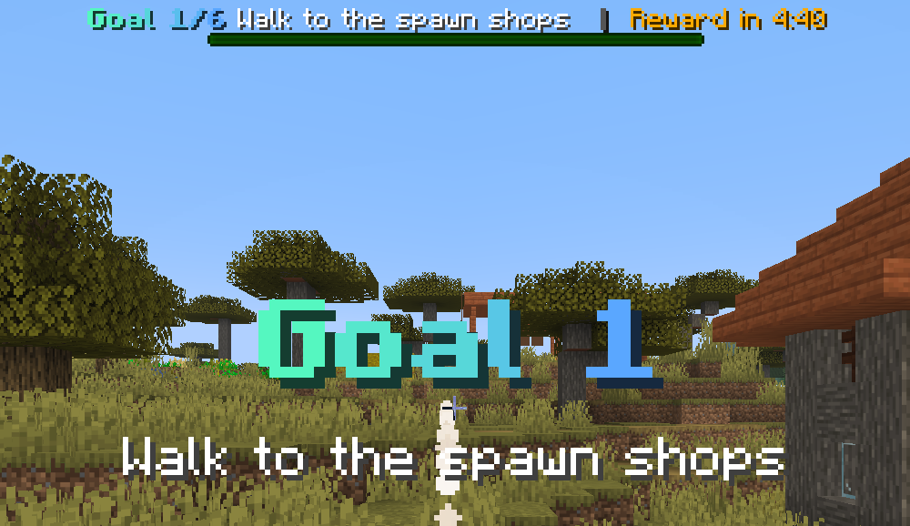
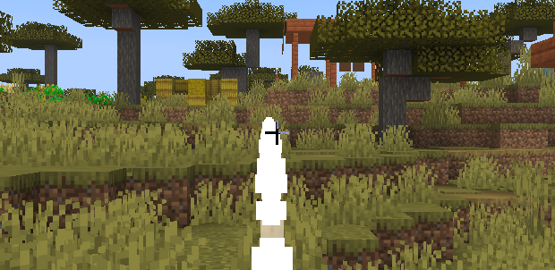
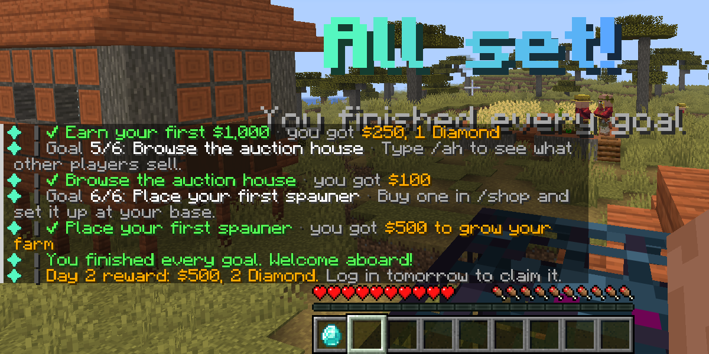

## Who counts as new

A player is new when FirstHour has no record of them and they are not an existing veteran. On their first join FirstHour:

1. Gives them a path. On PRO with several paths, that's the first path in `paths.yml` they have permission for.
2. Shows the welcome screen after `welcome.delay-ticks` (40 ticks, 2 seconds).
3. Puts their first goal on the bossbar.
4. On PRO, pings veterans so someone can say hi. See [Veterans say hi](/firsthour/veterans).

When you add FirstHour to a running server, players with 30 or more minutes of playtime count as veterans. They get no path and stay out of your new-player stats. See [`new-players`](/firsthour/configuration#new-players).

## The welcome screen

The screen has a title, a short line of text and one **Start** button.

<Tabs>
  <Tab title="Paper 26.1">
    A native dialog. Players press **Start** or close it with Escape. The button works once, for 30 minutes.

    <Frame>
      
    </Frame>
  </Tab>
  <Tab title="Paper 1.21.4">
    A title and subtitle, then a chat welcome with a clickable **[Start]** line. Clicking it runs `/firsthour start`.
  </Tab>
</Tabs>

FirstHour uses the native dialog whenever the server has Paper's Dialog API. If the dialog ever fails to open, it logs a warning and falls back to the chat welcome.

Edit the text under `welcome:` in `messages.yml`. Set `welcome.enabled: false` in `config.yml` to skip the screen. New players still get their path and the bossbar.

<Note>
The path is live from the first join. Pressing Start shows the first goal with a title and a sound, but players make progress whether they press it or not.
</Note>

## Start

Start shows a **Goal 1** title with the goal as its subtitle, plays the `goal-start` sound, and sends the goal and its hint in chat:

```text
Goal 1/6: Walk to the spawn shops · Follow the sparkles. Everything you sell starts here.
```

<Frame>
  
</Frame>

## The bossbar

While a player has goals left, the bossbar shows:

- the goal number and total, for example `Goal 1/6`
- the goal's title
- a live counter for goals that need more than one action
- the time to the next timed reward

The bar fills as the goal progresses. Counters look like this:

| Goal | Counter |
| --- | --- |
| Count goals (`break`, `craft`, `kill`...) with `amount` above 1 | `(3/8)` |
| `earn` | `($120/$1000)` |
| `playtime` | `(4/10 min)` |
| One-off goals | none |

After the path is done, the bar shows `Next reward in 27:04` until every timed reward is paid, then hides. Set colour and style with `bossbar.color` and `bossbar.style`, or turn it off with `bossbar.enabled: false`.

## Trail and compass

`go_to` goals point the way. Every 2 seconds by default, FirstHour draws a short line of particles from the player toward the target. Only that player sees it. When the goal is announced, their compass points at the target too.

<Frame>
  
</Frame>

The trail only draws when the player is in the target's world. Change the particle, colour, size, timing and length under `trail:` in `config.yml`.

## Finishing goals

When a goal is done, the player gets a check line with the reward, and the `step-done` sound:

```text
✔ Walk to the spawn shops · you got $50
```

Then the next goal appears in chat. If the player already did the next goal and it has `skip-if-done: true`, it ticks off straight away. That can chain through several goals at once.

When the last goal is done, the player sees an **All set!** title, hears `path-complete`, and gets a line about tomorrow's reward. See [Come-back days](/firsthour/rewards#come-back-days).

<Frame>
  
</Frame>

## Coming back mid-path

A player who logs off halfway picks up where they stopped:

```text
Welcome back! Goal 3/6: Make your first sale (/firsthour)
```

Players can type `/firsthour` any time to see their current goal, its hint, and the time to the next timed reward.

## Skipping

Players with `firsthour.skip` (everyone, by default) can run `/firsthour skip`. That ends their goals and the bossbar.

<Warning>
Skipping also stops that player's timed rewards and come-back rewards. Remove `firsthour.skip` from players if you don't want them to opt out. A skipped player still counts as a new player in your stats, but leaves the step funnel.
</Warning>

To put a player back on the path, run `/firsthour reset <player>`. That wipes their FirstHour data, and online players start over as brand-new players.
