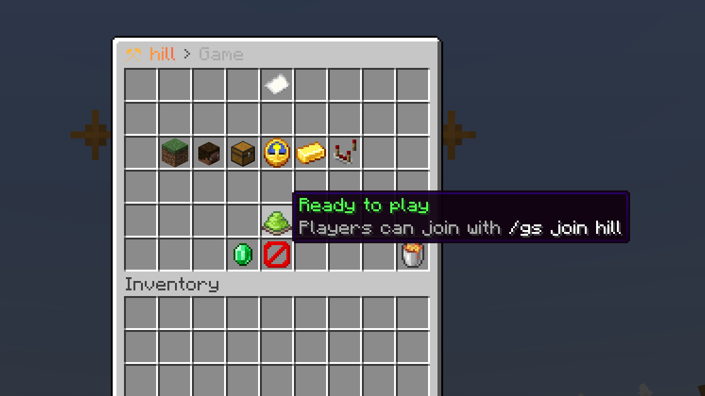

This walkthrough builds a small King of the Hill from nothing. It touches every part of the editor once: the arena, a zone, the kit, a phase with rules, the win rule and a reward. It takes about five minutes.

You need `gamesmith.admin` (ops have it). Build a floor and a small hill first, or use any open area you like.

<Steps>
  <Step title="Create a blank game">
    ```text
    /gs create hill
    ```

    With no template named, Gamesmith makes a `blank` game. It has one phase called `play` that lasts 300 seconds, and no arena yet. The editor opens on the game's hub.

    The hub lists what is missing under a red dye, for example `Set the arena region with the wand.` Work down that list.
  </Step>
  <Step title="Select and set the arena">
    Click **Arena**, then **Wand**. You get the Gamesmith wand (a blaze rod).

    Left-click a block for corner 1. Right-click a block for corner 2. Chat shows each corner and the size. Include everything the match may change, from the lowest floor block to the highest point a player can reach.

    Run `/gs edit hill`, click **Arena**, then **Set arena region**. Blocks inside the region are restored after every match.
  </Step>
  <Step title="Place the lobby and spawns">
    Still in **Arena**, stand where players should wait and click **Set lobby here**. Then stand on each start point and click **Add spawn here**. Add as many spawns as you like; players take turns through them.

    Markers use where you stand and the direction you face, rounded to the nearest 45 degrees. The lobby and every spawn must be inside the arena region.
  </Step>
  <Step title="Make the hill a zone">
    Select the hill with the wand: corner 1 on one side, corner 2 on the other, a few blocks up so a player standing on it is inside. Click **New zone from selection** and name it `hill`.

    Turn on **Preview** to see the region, markers and zones as particles and floating labels. Only you see them.
  </Step>
  <Step title="Save a kit">
    Put a stone sword and a leather chestplate in your inventory. In the hub, click **Kit**, then **Use my inventory**. Gamesmith saves exactly what you carry, armour and off-hand included, with enchantments and names.
  </Step>
  <Step title="Turn on PvP">
    In the hub, click **Phases & rules**, then the `play` phase. Click **PvP** to switch it on. Rename the phase with the card at the top if you like; the name shows on the boss bar.
  </Step>
  <Step title="Score on the hill">
    In the phase, click **Add rule** and pick **Player holds a zone**. Set **zone** to `hill`. Leave **every** at 1 and **contested** at `pause`, so nobody scores while two players share the hill. Click **Done**.

    Click **Add action** and pick **Change score**. Leave **amount** at 1 and **target** at `self`. Click **Done**.

    Optional: add an **Action bar** action with the text `<gold>+1 on the hill <gray>· <white><score>` so players see their score.
  </Step>
  <Step title="Respawn instead of elimination">
    Click **Add rule** and pick **Player dies**. Add a **Respawn** action with **delay** 3.

    Without a death rule, a player who dies is eliminated and watches the rest as a spectator.
  </Step>
  <Step title="Set the win rule and a reward">
    In the hub, click **Win & rewards**. Pick **First to a score** and set **Target score** to 60.

    Click **Add winner reward** and type `xp:50`. Add `item:DIAMOND 3` too if you like.
  </Step>
  <Step title="Test it">
    The hub now shows **Ready to play** under a lime dye. Click **Test**. The match starts right away, even if you are alone. Walk onto the hill and watch your score climb.

    When you are happy, tell players to run `/gs join hill` or pick it from `/gs`.
  </Step>
</Steps>

<Frame>
  
</Frame>

Every click saves the game straight away. The action bar shows `✔ Saved`. There is no save button and nothing to reload.

## Where to go next

- Add a second phase, such as a one-minute **Sudden death** with double points. See [The editor](/gamesmith/editor#phases-and-rules).
- Split players into teams in **Players & teams**. Team spawns go in **Arena** under **Add team spawn here**.
- Browse every trigger and action in [Rules](/gamesmith/rules).
- Compare with the `koth` preset: `/gs create koth2 koth`, then `/gs edit koth2`.
