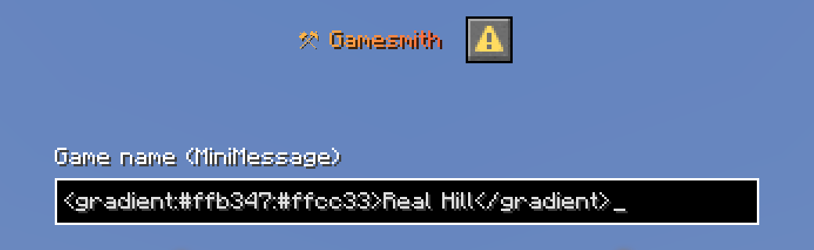
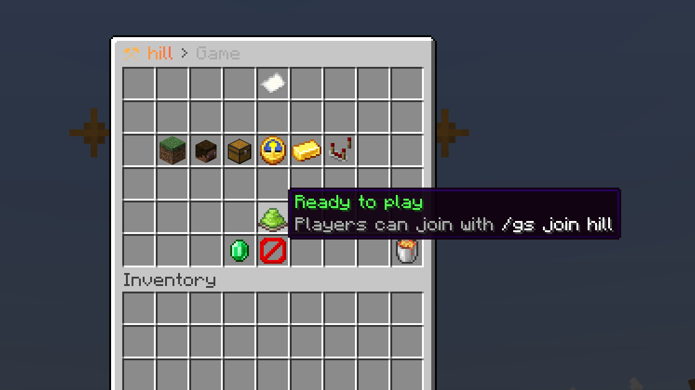
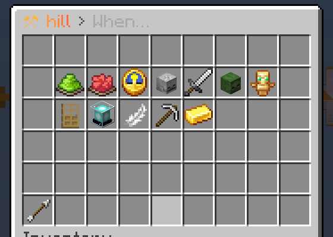
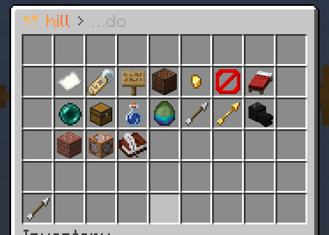

The editor is a set of chest menus. Every field of a game is a click or one typed value away, and every change saves the moment you make it. You never edit a file unless you want to.

```text
/gs edit <id>
```

`/gs create` opens the editor too. You need `gamesmith.admin`. You cannot edit while you are in a match, or while the game you want to edit is running (stop it first with `/gs stop <id>`).

## Typing values

When the editor needs a name, a number or a block, it asks you:

- **On Paper 1.21.6 and newer:** a native input form with **Save** and **Cancel**.
- **On older servers:** one chat line. Type the value, or type `cancel` to go back.

Invalid input says what is wrong and asks again. To always use chat, set `editor.input: chat` in `config.yml`.

<Frame>
  
</Frame>

Names and texts accept [MiniMessage](https://docs.advntr.dev/minimessage/format.html), so `<gradient:#ffb347:#ffcc33>Real Hill</gradient>` works as a game name.

## The hub

The hub is the game's home page.

<Frame>
  
</Frame>

| Button | What it does |
| --- | --- |
| Game card (paper, top) | Name, id, player range, phases and win rule at a glance |
| **Arena** | Region, lobby, spawns, mob spawns, team spawns and zones |
| **Players & teams** | Min and max players, countdown, teams |
| **Kit** | What everyone gets at the start |
| **Phases & rules** | The game itself: what happens when |
| **Win & rewards** | How the game is won and what players get |
| **Settings** | Name, icon, arena reset and early end |
| Status (lime or red dye) | **Ready to play**, or the list of problems to fix |
| **Test** | Starts a match now, even alone. Closes the editor |
| **Close** | Closes the editor |
| **Delete game** | Shift-click, then confirm. Removes the game file; arena blocks stay |

### The problem list

Players cannot join a game with problems. The red dye lists up to eight of them, for example:

- `Set the arena region with the wand.`
- `Set the lobby.` / `Add at least one spawn.`
- `The lobby must be inside the arena region.`
- `Team red has no spawn (spawn-red or spawn).`
- `Add a second team, or remove the team for free-for-all.`
- `Phase play, Fill a zone: pick a zone.`
- `World arenas is not loaded.`

When the list is empty, the dye turns lime and says **Ready to play**.

## Arena

Select areas with the wand, then use the selection here. Markers use the spot you stand on.

| Button | What it does |
| --- | --- |
| **Wand** | Gives you the wand. Left-click a block for corner 1, right-click for corner 2 |
| **Set arena region** | Uses your selection as the arena. Everything inside is restored after each match |
| **Set lobby here** | Where players wait, and where eliminated players watch. One position |
| **Add spawn here** | Adds a start point. Players take turns through the list |
| **Add mob spawn here** | Adds a point for the **Spawn mobs** action |
| **Add team spawn here** | Appears when the game has teams. Adds a `spawn-<team>` point |
| **New zone from selection** | Names your selection as a zone (lowercase letters, digits, `-` or `_`) |
| Marker list | Every marker and its count. Shift-right-click clears one |
| Zone list | Every zone. Click to replace it with your selection, shift-right-click to delete |
| **Preview** | Particles on the region, zones, markers and your selection, plus floating labels on markers and zones. Only you see them. On by default |

See [Arenas](/gamesmith/arenas) for how regions, markers and zones behave in a match.

## Players & teams

| Button | Range | What it does |
| --- | --- | --- |
| **Min players** | 1 to max | The countdown starts when this many have joined |
| **Max players** | min to 100 | Joining stops here. A full game cuts the countdown to 5 seconds |
| **Countdown (seconds)** | 5 to 120 | Lobby countdown before the match |
| **Free-for-all** / teams | up to 8 teams | Click to add a team. The first click adds two |

Steppers: left-click adds, right-click subtracts, shift for bigger steps.

Teams come in this order: red, blue, green, yellow, aqua, light purple, gold and white. Shift-right-click a team to remove it. Removing down to one team goes back to free-for-all. Teams are filled evenly when the match starts, and friendly fire is off.

## Kit

The kit replaces each player's inventory when the match starts, and again for the **Give kit** and **Respawn** actions.

- **Use my inventory** saves exactly what you carry now, armour and off-hand included. The wand is left out.
- **Clear kit** (shift-click) empties it.

Armour pieces go straight onto the player.

## Phases and rules

A game is a list of phases: a warm-up, the fight, sudden death. Each phase has its own length, its own permissions and its own rules.

The phase list:

- **Click** a phase to edit it.
- **Right-click** to duplicate it.
- **Shift-left-click** to move it earlier.
- **Shift-right-click** to delete it (a game keeps at least one).
- **Add phase** asks for an id (lowercase letters, digits, `-` or `_`). New phases last 60 seconds.

Inside a phase:

| Button | What it does |
| --- | --- |
| Phase card (top) | Rename the phase. The name shows on the boss bar |
| **Length** | Seconds. `0` means no time limit: the phase runs until a rule moves on |
| **Breakable blocks** | Block names with commas (`SNOW_BLOCK, SAND`), `*` for any, or `none` |
| **PvP** | Players can hurt each other |
| **Fall damage** | On by default |
| **Hunger** | Hunger drains |
| **Place blocks** | Players can place blocks, buckets and similar inside the arena |
| **Item and block drops** | Broken blocks and items drop |
| **Add rule** | Pick a trigger, then add actions |

When a phase's time runs out, the next phase starts. After the last phase, the game ends and the win rule picks the winner.

### Rules

A rule is "when this happens, do these things". Click **Add rule**, pick what it reacts to, set its settings, then add actions. Actions run top to bottom.

<Frame caption="The trigger picker: 12 things a rule can react to">
  
</Frame>

<Frame caption="The action picker: 17 things a rule can do">
  
</Frame>

On the rule page:

- Click the **When** card to change the trigger's settings.
- Click an action to change its settings.
- Shift-left-click an action to move it earlier. Shift-right-click to remove it.

Each setting shows its current value and a hint:

| Setting type | How you set it |
| --- | --- |
| Number | Type a number in the allowed range |
| Text | Type up to 256 characters. MiniMessage works |
| Choice | Click for the next option, right-click for the previous one |
| Zone, phase, marker | Pick from the game's own list |
| Block | Type a block name, or right-click with a block in your hand |
| Mob | Type a mob type such as `ZOMBIE`, or `mythic:<id>` on PRO |
| Effect | Type an effect such as `speed` or `regeneration` |
| Sound | Type a sound key such as `entity.experience_orb.pickup` |

Every trigger and action is listed in [Rules](/gamesmith/rules).

<Note>
On Lite, the console command and Typewriter actions show as locked tiles marked PRO. Set `pro-hints: false` in `config.yml` to hide them.
</Note>

## Win & rewards

Pick one win rule:

| Win rule | Who wins |
| --- | --- |
| **Last one standing** | The last player or team left |
| **First to a score** | The first player or team to the **Target score** |
| **Highest score** | The highest score when the last phase ends |
| **Survive together** | Co-op: everyone still alive at the end |

Then add rewards:

- **Winner reward:** given to the winners.
- **Reward for everyone:** given to everyone in the match when it ends, winners and eliminated players included.

Type one reward per line:

| Reward | Example | Edition |
| --- | --- | --- |
| XP points | `xp:50` | Lite and PRO |
| Item | `item:DIAMOND 3` or `item:DIAMOND_SWORD 1 sharpness:3` | Lite and PRO |
| Money through Vault | `money:100` | PRO |
| Console command | `command:give {player} diamond 1` | PRO |

`{player}` becomes the player's name. Rewards are handed out after the player's own inventory is back. Items that do not fit drop at the player's feet. Shift-right-click a reward to remove it.

## Settings

| Button | What it does |
| --- | --- |
| **Name** | The game's display name (MiniMessage, up to 64 characters) |
| **Icon** | Click with an item in your hand. The game uses it in the `/gs` menu |
| **End when too few stay** | On by default. If players leave mid-match and fewer than the minimum remain, the match ends. In a contest, the win rule picks the winner from the players still in. A co-op game just stops. Matches started with `/gs start` or **Test** keep going |
| **Arena reset** | PRO on AdvancedSlimePaper: **Put blocks back** or **Fresh world per match** |
| **Build template** | Shows in fresh-world mode. Copies the arena as it is now into the match template |

See [Arenas](/gamesmith/arenas#fresh-worlds-pro) for fresh worlds.

## Customising the editor

Button names, lore, materials and slots live in `plugins/Gamesmith/editor.yml`. Run `/gs reload` after editing. See [Configuration](/gamesmith/configuration#editor-text).
