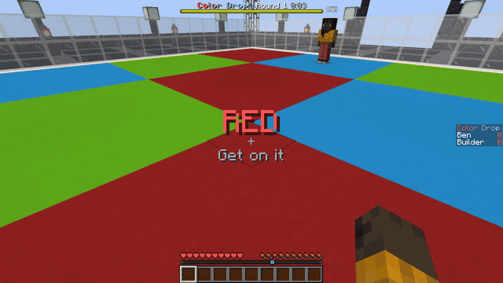

<Frame>
  
</Frame>

**Gamesmith** lets you build minigames in-game. A game is an arena, its spawns and zones, a few phases, and rules like "when a player falls below Y 5, eliminate them". You click those together in a chest-menu editor, press **Test**, and you are in a match with a countdown, a boss bar timer, a live scoreboard and rewards at the end.

Nine games ship ready to play. `/gs create` builds one at your feet, arena included. When a match ends, every player gets their inventory, XP, health, effects and location back, and the arena is put back block for block.

## Get Gamesmith

<CardGroup cols={2}>
  <Card title="Gamesmith PRO" icon="gem">
    Available on Voxel Shop. Unlimited games, MythicMobs, Typewriter, money and command rewards, leaderboards, placeholders and fresh-world matches.
  </Card>
  <Card title="Gamesmith Lite" icon="download">
    The free edition: the full editor and all nine presets, up to three games. Coming soon.
  </Card>
</CardGroup>

PRO needs a licence key. You claim it in Discord with `/claim GAMESMITH`. See [Installation](/gamesmith/installation).

## What you get

- **Nine games on day one:** Sumo, Color Drop, Lava Rising, Sky Sprint, Domination, Outpost Raid, Spleef, King of the Hill and Mob Waves. Six bring a complete themed map.
- **A real editor:** every preset is built with the same editor you get, so you can open any of them and change anything.
- **Rules without code:** 12 triggers and 17 actions. King of the Hill is three rules.
- **Teams, kits, win rules and rewards:** free-for-all or up to eight coloured teams, four ways to win, rewards for winners and for everyone.
- **Nothing breaks your world:** players and arenas come back as they were after every match, and a crash mid-match does not lose them.
- **Plays with your stack:** MythicMobs bosses, Typewriter entries, Vault money and PlaceholderAPI (PRO).

## Lite vs PRO

| | Gamesmith Lite (free) | Gamesmith PRO |
| --- | --- | --- |
| GUI editor, 12 triggers, nine presets | Yes | Yes |
| Actions | 15 | 17 (adds console command and Typewriter entry) |
| Games on the server | 3, presets included | Unlimited |
| Mobs | Vanilla | Vanilla and MythicMobs (`mythic:<id>`) |
| Rewards | XP and items | XP, items, Vault money and console commands |
| `/gs top` leaderboards | No | Yes |
| PlaceholderAPI placeholders | No | Yes |
| Arena reset | Put blocks back | Put blocks back, or a fresh world per match on AdvancedSlimePaper |
| Licence key | Not needed | Required |

Lite still records wins and games played. Players see their wins on each game in the `/gs` menu.

## Compatibility

- **Server software:** Paper `1.20.6` through `26.3`. Spigot and Folia are not supported.
- **Java:** 21 or newer. Paper `26.x` servers need Java 25.
- **Required plugins:** none.
- **Optional plugins:** MythicMobs, Typewriter, Vault with an economy plugin, PlaceholderAPI and AdvancedSlimePaper (all used by PRO features). Multiverse-Core, Hyperverse, MultiWorld and MyWorlds load before Gamesmith when present, so arenas in their worlds work.
- **Editor input:** a native input form on `1.21.6` and newer, one chat line on older servers.

<Note>
Gamesmith PRO checks its licence key on every startup, so the server needs internet access. See [Installation](/gamesmith/installation#claim-your-licence-key).
</Note>

## Quick commands

```text
/gs                         pick a game from the menu
/gs join <game>             join a game
/gs create lava lavarise    build Lava Rising at your feet
/gs edit lava               open the editor
/gs list                    every game and its state
```

## Documentation sections

<CardGroup cols={2}>
  <Card title="Installation" icon="download" href="/gamesmith/installation">
    Drop the jar, claim the PRO key, make your first game.
  </Card>
  <Card title="Preset games" icon="gamepad" href="/gamesmith/presets">
    The nine ready-to-play games and how each one works.
  </Card>
  <Card title="Build a game" icon="hammer" href="/gamesmith/build-a-game">
    King of the Hill from a blank game, step by step.
  </Card>
  <Card title="The editor" icon="table-cells" href="/gamesmith/editor">
    Every menu: arena, teams, kit, phases, rules, win, settings.
  </Card>
  <Card title="Rules" icon="bolt" href="/gamesmith/rules">
    All 12 triggers and 17 actions, with their settings.
  </Card>
  <Card title="Arenas" icon="map" href="/gamesmith/arenas">
    Regions, markers, zones, protection and arena resets.
  </Card>
  <Card title="Matches" icon="flag-checkered" href="/gamesmith/matches">
    Lobby, countdown, scoring, eliminations, restores.
  </Card>
  <Card title="Integrations" icon="puzzle-piece" href="/gamesmith/integrations">
    MythicMobs, Typewriter, Vault, PlaceholderAPI, AdvancedSlimePaper.
  </Card>
  <Card title="Commands" icon="terminal" href="/gamesmith/commands">
    Player and admin `/gs` commands.
  </Card>
  <Card title="Permissions" icon="key" href="/gamesmith/permissions">
    `gamesmith.play`, `gamesmith.admin` and `gamesmith.bypass`.
  </Card>
  <Card title="Configuration" icon="gear" href="/gamesmith/configuration">
    `config.yml`, `messages.yml`, `editor.yml` and game files.
  </Card>
  <Card title="Placeholders" icon="code" href="/gamesmith/placeholders">
    PRO PlaceholderAPI placeholders for wins, games and scores.
  </Card>
  <Card title="FAQ" icon="circle-question" href="/gamesmith/faq">
    Licence, limits, resets, Lite cap and troubleshooting.
  </Card>
</CardGroup>

## Support

<Card title="Discord" icon="discord" href="https://discord.gg/kgHNjJsB2t">
  Claim your PRO key with `/claim GAMESMITH` and get support.
</Card>
