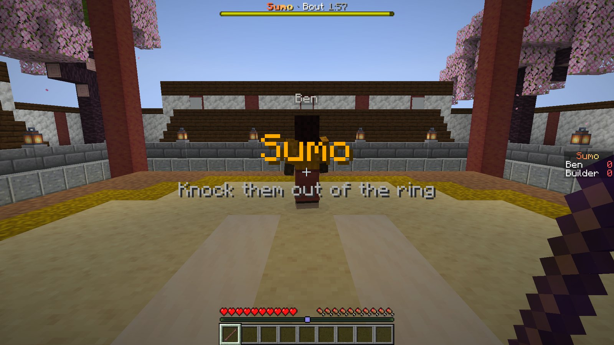
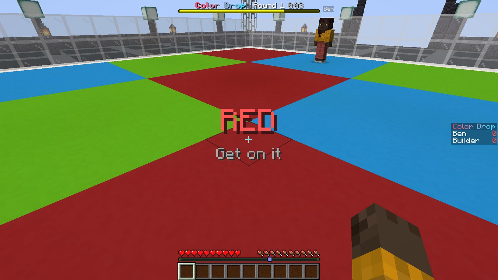
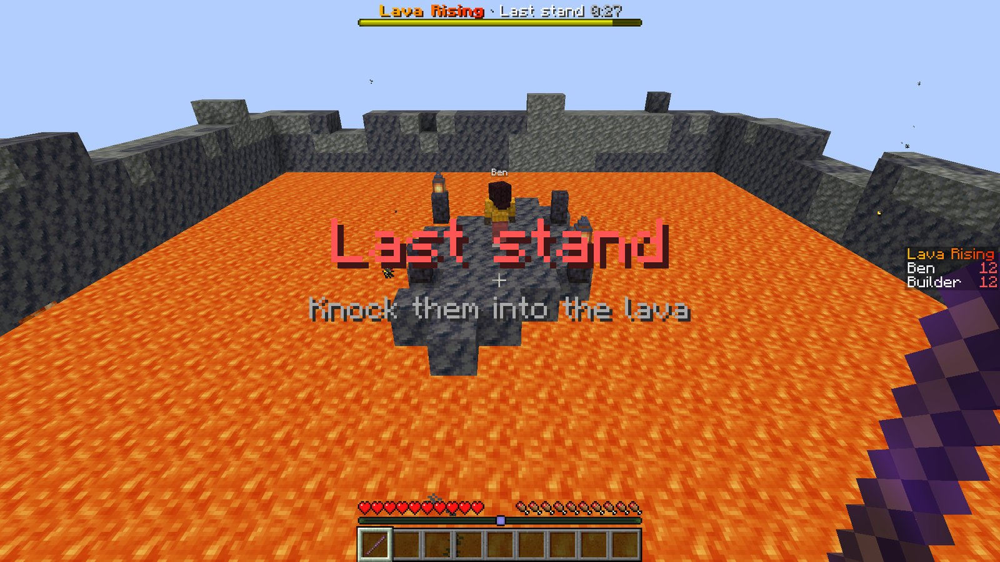
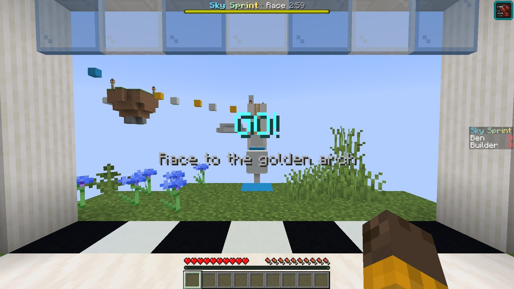
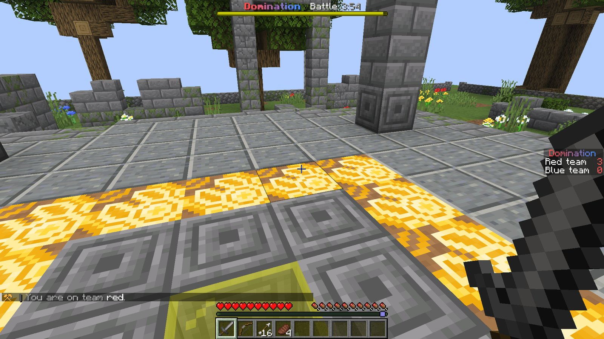
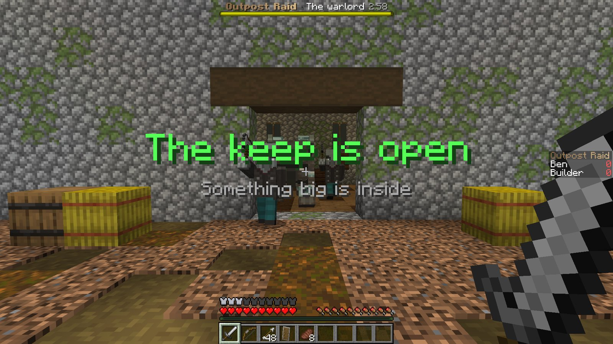

Gamesmith ships nine games. Each one is a template: `/gs create` copies it into a new game, builds its arena where you stand and opens the editor. Every preset is made with the same editor you use, so you can open it and change any part.

```text
/gs create <id> <template>
```

For example, `/gs create sumo1 sumo` makes a game called `sumo1` from the Sumo template. You can make several games from one template.

<Warning>
Building a preset replaces the blocks around you. Use an empty area. See [Installation](/gamesmith/installation#make-your-first-game).
</Warning>

## At a glance

| Template | Game | Players | Win | Play area (blocks) |
| --- | --- | --- | --- | --- |
| `sumo` | Sumo | 2–8 | Last one standing | 41 × 41 |
| `colordrop` | Color Drop | 2–12 | Last one standing | 33 × 33 |
| `lavarise` | Lava Rising | 2–10 | Last one standing | 25 × 27 |
| `skysprint` | Sky Sprint | 2–8 | First across the finish | 43 × 40 |
| `domination` | Domination | 2–16, red vs blue | First team to 200 | 53 × 41 |
| `outpost` | Outpost Raid | 1–6, co-op | Survive together | 35 × 43 |
| `spleef` | Spleef | 2–12 | Last one standing | 29 × 35 |
| `koth` | King of the Hill | 2–8 | First to 60 | 35 × 41 |
| `waves` | Mob Waves | 1–6, co-op | Survive together | 29 × 35 |
| `blank` | Your own game | You choose | You choose | You choose |

The first six place a complete themed map from the jar. Spleef, King of the Hill and Mob Waves build a simple arena from blocks. `blank` places nothing; see [Build a game](/gamesmith/build-a-game).

### Space each map needs

A map preset first clears its whole box, which is bigger than the play area, then places the map. The box starts a few blocks below your feet.

| Template | Box cleared (width × length × height) | Starts below your feet |
| --- | --- | --- |
| `sumo` | 46 × 45 × 32 | 12 blocks |
| `colordrop` | 35 × 36 × 27 | 12 blocks |
| `lavarise` | 43 × 43 × 24 | 4 blocks |
| `skysprint` | 69 × 48 × 37 | 15 blocks |
| `domination` | 74 × 59 × 21 | 4 blocks |
| `outpost` | 46 × 53 × 23 | 4 blocks |

Spleef, King of the Hill and Mob Waves clear nothing. They place their own blocks, such as a floor, walls and a lobby pad, over what is there.

On a Lite server every game counts toward the three-game limit, presets included.

## Sumo

<Frame>
  
</Frame>

A raised ring over a water pit and a knockback stick. Knock everyone off.

- **Kit:** a stick with Knockback II. Everyone gets Resistance V, so hits push instead of hurt.
- **Bout (2:00):** fall off the ring and you are out.
- **Sudden death (0:45):** the ring's edge drops away.
- If sudden death runs out, everyone still in the ring shares the win.
- **Reward:** 50 XP for the winner.

## Color Drop

<Frame>
  
</Frame>

A festival stage with a 3×3 floor of red, lime and light blue tiles. A colour is called, every other tile falls into the pit, and the floor comes back for the next call.

- **Seven rounds.** The call gives you 4 seconds in rounds 1–2, 3 seconds in rounds 3–4 and 2 seconds in rounds 5–7.
- Every survivor scores a point per round.
- Fall in and you are out. After round 7, everyone still standing shares the win.
- **Rewards:** 60 XP for winners, 10 XP for everyone.

## Lava Rising

<Frame>
  
</Frame>

A volcano crater with spiral paths of basalt columns. The lava climbs; you climb faster.

- **Calm (0:10):** get moving.
- **Six rises (0:15 each):** the lava climbs two blocks at the start of each.
- **Last stand (0:30):** knock rivals into the lava.
- **Kit:** a stick with Knockback I. PvP is on the whole match.
- Die, in the lava or from a fall, and you are out. Survivors score a point every 5 seconds during the rises.
- **Rewards:** 60 XP for the winner, 10 XP for everyone.

## Sky Sprint

<Frame>
  
</Frame>

A parkour race between two floating islands: fence posts, a ladder tower and a jump pad.

- Everyone runs with Speed I.
- Fall and you are sent back to the start.
- The jump pad gives Jump Boost II for 5 seconds.
- First through the golden arch wins.
- **Race (3:00):** if nobody finishes in time, nobody wins.
- **Reward:** 50 XP for the winner.

## Domination

<Frame>
  
</Frame>

Red against blue in castle ruins with three capture points.

- **Teams:** red and blue, filled evenly at the start.
- **Kit:** stone sword, bow, 16 arrows, 4 cooked beef.
- Hold a point to score a point every 2 seconds. A point shared with the other team scores nothing.
- A takedown scores 3. You respawn 3 seconds after dying.
- **Battle (4:00), then final minute (1:00):** points count double in the final minute.
- First team to 200 wins. Otherwise the higher team score wins when time runs out.
- **Rewards:** 60 XP for winners, 10 XP for everyone.

## Outpost Raid

<Frame>
  
</Frame>

A co-op raid in three stages. Each stage has 3 minutes.

1. **Storm the walls:** shoot six pillagers off the walls and towers. The gate opens when they are all dead.
2. **The courtyard:** four vindicators and two pillagers. The keep door opens when they fall.
3. **The warlord:** a ravager and two vindicators inside the keep. Kill them all to win.

- **Kit:** iron sword, bow, 48 arrows, shield, iron chestplate, 8 cooked beef.
- You respawn 5 seconds after dying.
- Mob kills score 1 point, 3 in the keep.
- If any stage runs out of time, the raid fails and nobody wins.
- **Reward:** 100 XP for the winners.

## Spleef

Dig the snow out from under your rivals.

- **Arena:** a snow floor inside glass walls, over a pit.
- **Kit:** an unbreakable diamond shovel with Efficiency V. Only snow blocks can be broken.
- Fall into the pit and you are out. Last one standing wins.
- **Time limit (5:00):** everyone still standing shares the win.
- **Reward:** 50 XP for the winner.

## King of the Hill

Hold the hill alone to score.

- **Arena:** a stone floor with a gold hill in the middle.
- **Kit:** stone sword and leather chestplate. PvP is on.
- Standing on the hill scores a point every second, but only while no rival shares it.
- You respawn 3 seconds after dying.
- First to 60 wins. After 4 minutes, the highest score wins.
- **Reward:** 50 XP for the winner.

## Mob Waves

Survive three waves together.

1. **Wave 1:** four zombies.
2. **Wave 2:** four zombies and two skeletons. Everyone gets Regeneration II for 5 seconds.
3. **Boss wave:** a MythicMobs `SkeletalKnight` and three zombies, with another 5 seconds of Regeneration II. Without MythicMobs (or on Lite), a skeleton takes the knight's place.

- **Kit:** iron sword, bow, 32 arrows, iron chestplate, 8 cooked beef.
- Each wave ends when its mobs are dead. There is no time limit.
- Dying knocks you out. Everyone still alive after the boss wave wins.
- **Reward:** 100 XP for the winners.

<Note>
Mob Waves and Outpost Raid need a world where hostile mobs can live. On a peaceful world, hostile mobs vanish as they spawn and the wave clears itself. The console warns you when this happens.
</Note>

## Make a preset your own

Open any preset with `/gs edit <id>` and change it. Some ideas:

- **Rewards:** add `item:DIAMOND 3` to the winner reward, or `money:100` on PRO.
- **Length:** change a phase's length in **Phases & rules**.
- **Kit:** hold what you want players to get and click **Use my inventory** in **Kit**.
- **A harder boss:** on PRO with MythicMobs, change the boss wave's spawn action to your own `mythic:<id>`.

See [The editor](/gamesmith/editor) for every menu.
