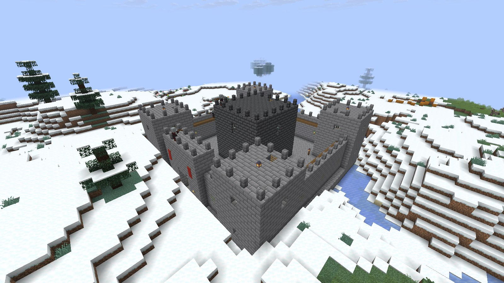

<Note>
Custom forts are a **Raid Bases PRO** feature.
</Note>

Build a fort, save it as a `.schem`, drop it in the `forts` folder and add it to a tier. Raid Bases raises it, guards it, lets players crack its vault and puts the land back after, the same as a built-in fort.

<Frame>
  
</Frame>

Raid Bases reads Sponge schematics (version 2 and 3) itself. That is the format WorldEdit and FastAsyncWorldEdit write with `//schem save`. WorldEdit doesn't need to be installed on the raid server.

## Make a fort

<Steps>
  <Step title="Build it">
    Build your fort on a flat test area. Put a **vault** block where the loot should come out. A **lodestone** also works, which is handy on 1.20.6.
  </Step>
  <Step title="Include the floor">
    Select from the ground layer up. The bottom layer of the schematic sits at ground level, and the foundation fills any gaps under it.
  </Step>
  <Step title="Save it">
    Run `//copy`, then `//schem save frostkeep`. Use a lowercase name with only letters, digits, `_`, `.` and `-`.
  </Step>
  <Step title="Drop it in the forts folder">
    Copy `frostkeep.schem` into `plugins/RaidBases/forts/`. Raid Bases PRO creates that folder on startup.
  </Step>
  <Step title="Try it">
    Run `/raid start here medium schem:frostkeep`.
  </Step>
</Steps>

To have the schedule raise it, add `schem:frostkeep` to a tier's `layouts`, then run `/raid reload`:

```yaml title="plugins/RaidBases/config.yml"
tiers:
  medium:
    layouts: [keep, watchtower, castle, "schem:frostkeep"]
```

The file is read each time a raid starts, so you can replace it without a reload.

## Rules for a schematic fort

| Rule | Details |
| --- | --- |
| Format | Sponge `.schem` version 2 or 3. Legacy `.schematic` files don't work |
| Size | Up to 96 blocks wide and long, and 64 high |
| Vault | Needs a vault block or a lodestone. The first one found becomes the vault, facing south |
| File name | Letters, digits, `_`, `.` and `-` only. Keep it lowercase: tier layouts and commands are read in lowercase |
| Foundation | Comes from the tier's `palette.foundation` |
| Guards | Use the tier's `guards` list |

### Blocks that leave the land alone

- **Structure void** blocks leave whatever is already there.
- **Air in the bottom layer** leaves the ground as it is.

Air anywhere else clears that space, so the inside of your fort stays open.

### Guard posts

Raid Bases finds guard posts by itself: any spot with solid footing and two blocks of air above it, at least 4 blocks from the next post, up to 32 posts. It sorts them like this:

| Post | Where |
| --- | --- |
| `keep` | Within 4 blocks of the vault, and within 2 blocks of its height |
| `yard` | Standing on the bottom layer |
| `tower` | In the top third of the build |
| `wall` | Everywhere else |

Give guards a `post` that your build has, or `any`.

### Signs, banners and heads

Sign text, banner patterns and player-head skins come across from the schematic.

Chests, barrels and other containers rise **empty** on purpose: the vault is the loot. Other block entity data, like spawner mobs or lectern books, doesn't come across.

## When a fort won't load

If the file can't be used, the raid doesn't start. Chat says `No fort schematic called <name>` whatever the cause, and the console says why. Common console reasons:

- `No fort schematic plugins/RaidBases/forts/<name>.schem`: the file isn't in that folder, or its name has capital letters.
- `it has no vault block`: add a vault or a lodestone.
- `forts can be up to 96 wide and 64 high`: the build is too big.
- `only Sponge .schem files (v2, v3) work`: re-save it with `//schem save`.
- `may only use letters, digits, _ . and -`: rename the file.

In Raid Bases Lite, `schem:` forts say they are a PRO feature.
