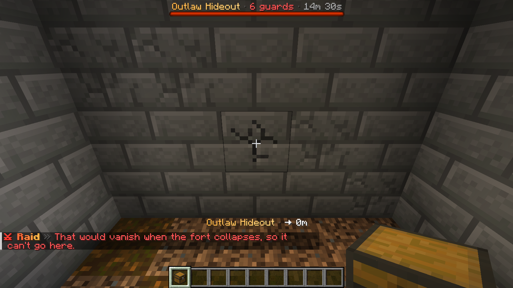

A fort defends itself three ways: guards at their posts, a vault that stays shut until they are down, and, in PRO, walls that take more than one hit.

## Guards

Guards are vanilla mobs. The defaults are raid mobs (pillagers, vindicators, evokers, witches and ravagers), plus wither skeletons in the Nightmare Bastion. You can use any mob that spawns, with its own name, health and gear.

What makes a guard different from a normal mob:

- **They hold their posts.** Each guard has a spot on the walls, a tower, the yard or the keep. A guard that wanders more than 20 blocks from its post is teleported back. One that drifts a few blocks with nothing to fight walks back.
- **They don't fight each other.** Guards can't target or damage other guards, arrows included.
- **They don't die to the fort.** Guards take no suffocation, fall, drowning, cramming, magma block, campfire or fire block damage, and blocks can't set them alight. They don't burn in daylight. Fire Aspect and Flame still burn them.
- **They stay what they are.** Guards don't transform, use portals, pick up items or join vanilla raids.
- **They don't stick around.** Guards are not saved with the world. When the raid ends, they are removed.
- **Their gear never drops.** Helmets, chestplates and their own weapons stay with them. The vault is the prize. Their normal mob drops do fall, unless you set `drops: false`.

Names show when you look at a guard and in death messages. They are not shown above every guard's head.

### Posts

Each generated fort marks guard posts as `wall`, `tower`, `yard` or `keep`. A few layouts also have `roof` posts. Set `post` on a guard entry to pick where it stands, or `any` to use every post. If a fort has no post of that kind, the guard uses any post.

```yaml title="plugins/RaidBases/config.yml"
guards:
  - type: pillager
    count: 6
    post: wall
    name: "<red>Bandit Archer"
  - type: vindicator
    count: 3
    post: yard
    name: "<red>Bandit Enforcer"
    health: 1.3
    gear:
      head: iron_helmet
      chest: iron_chestplate
  - type: witch
    count: 1
    post: keep
    name: "<dark_purple>Bandit Alchemist"
    drops: false
```

| Field | Meaning |
| --- | --- |
| `type` | Any mob id, like `pillager`, `vindicator`, `wither_skeleton` or `zombie` |
| `count` | How many spawn |
| `post` | `wall`, `tower`, `yard`, `keep`, `roof` or `any` |
| `health` | Times the mob's normal max health. `2.0` is double |
| `name` | MiniMessage name |
| `gear` | Items by slot: `head`, `chest`, `legs`, `feet`, `hand`, `offhand` |
| `drops` | `true` (default) keeps the mob's normal drops. `false` clears them |

## The vault

The vault is the block the loot comes out of. It is a vault block facing south. On Paper 1.20.6 the vault block needs an experimental flag, so it is a lodestone there unless the world has that flag on.

- Players can't break it or open it.
- Explosions can't break it.
- It unlocks once the guards alive drop to the tier's `unlock-guards-left` or fewer.
- Players crack it by standing within `vault.radius` blocks. See [How a raid plays out](/raidbases/raids#the-loop).

## Wall HP (PRO)

In Raid Bases PRO, each tier's `wall-hp` sets how many hits a fort block takes before it breaks. The default tiers use 2, 3, 4 and 5. A value of `1` means blocks break normally.

<Frame>
  
</Frame>

- The crack shows as you swing, and each hit plays the `wall-hit` sound.
- Hits are counted per block and per raid.
- Wall HP covers solid blocks the fort placed and nobody has changed since. Terrain inside the fort's area, and non-solid blocks such as banners, break normally.

<Note>
**TNT ignores wall HP.** Light TNT inside the fort's area, such as at the gate, and you can blow it open in one go.
</Note>

In Raid Bases Lite, fort blocks break normally.

## Explosions

TNT and creepers work inside a fort, with limits:

- A blast that **starts inside** a fort's area breaks blocks in that area only. Nothing drops.
- A blast that **starts outside** can't touch any fort.
- No blast breaks the vault, or anything while the fort is rising or collapsing.

## What players can do inside a fort

The fort's area is the footprint plus `site.margin` blocks of open ground on every side, from the foundation to a few blocks above the top. Inside it:

| Action | Allowed |
| --- | --- |
| Break blocks | Yes, but nothing drops and no XP. PRO wall HP applies to fort blocks |
| Place normal blocks | Yes. They are removed when the land is put back |
| Place chests, furnaces, hoppers, signs or other block entities | No. They would vanish with their contents when the fort collapses |
| Break or place anything while the fort is rising or collapsing | No |
| Take fall damage while the fort is rising or collapsing | No |
| Suffocate in a wall | No. Suffocation damage is off inside a fort |

Lanterns, ladders and banners that pop off a broken wall don't drop either. Everything inside the area comes back when the fort goes, so drops would be free blocks and ores.

## Containment

The edge of a fort's area works as a wall for the world around it:

- Water and lava can't flow in or out. Grass and other spreading blocks can't cross it.
- Fire can't spread into, out of or within a fort, blocks there don't burn away, and lava can't set them alight.
- Pistons can't push or pull blocks across the edge, or move anything while the fort is rising or collapsing.
- Mobs can't take or change blocks inside it. Sand and gravel can land in it, but nothing inside starts falling.
- Leaves within 7 blocks of a fort don't decay while it stands, so a tree the fort cut through keeps its leaves until its logs are back.
