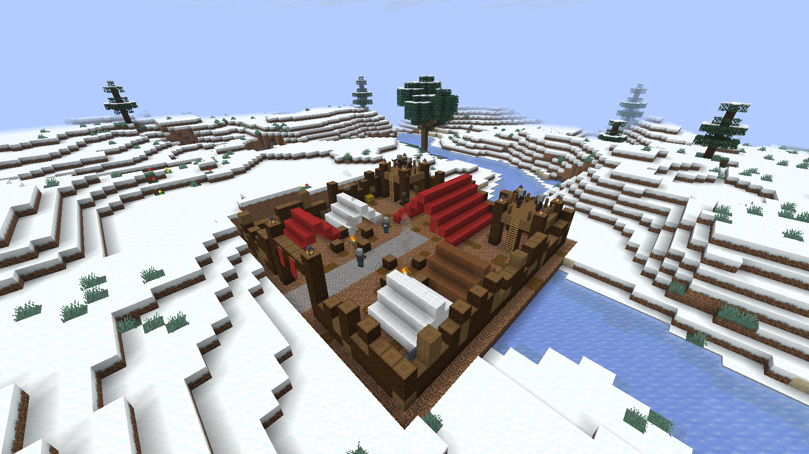
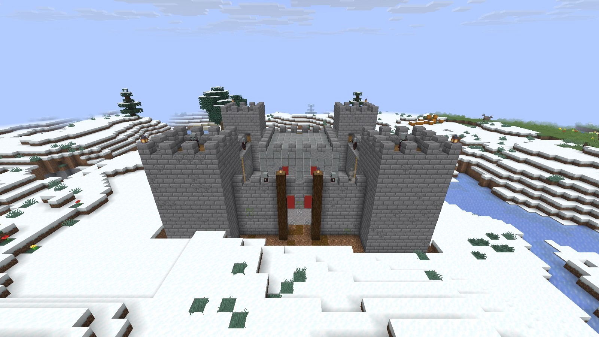
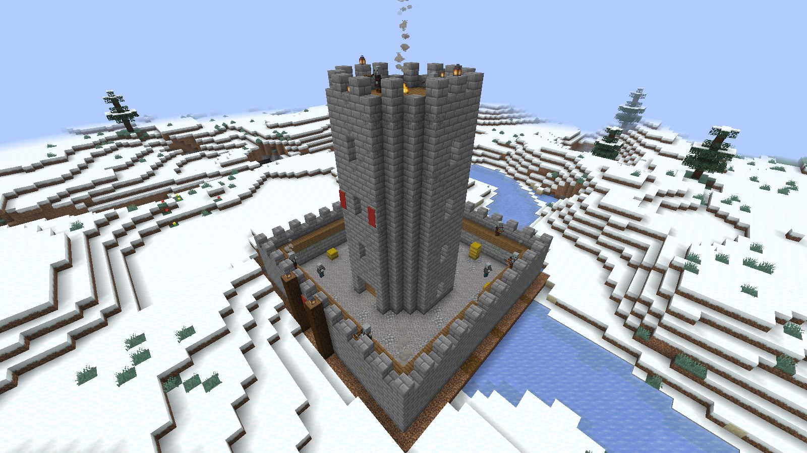
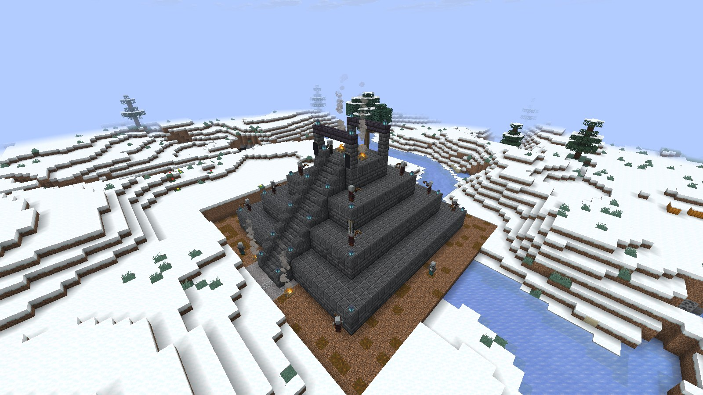
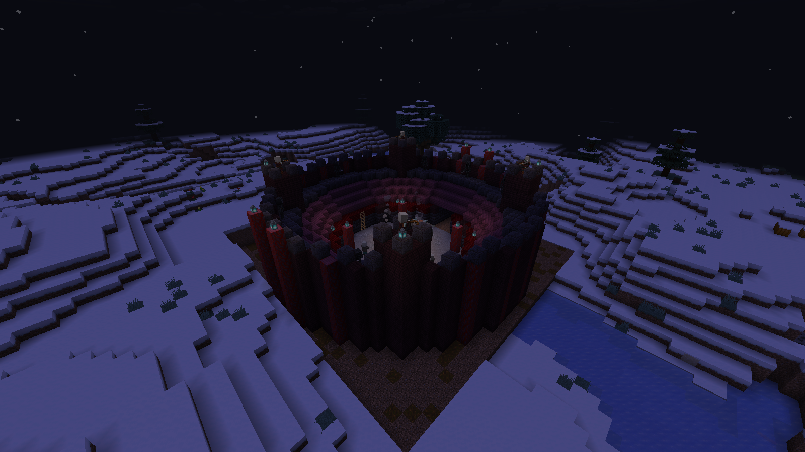

Every fort is generated when the raid starts. The layout sets the shape, the tier's palette sets the blocks, and a random seed adds variation, so no two raids look quite the same. Every gate faces south.

## The 11 layouts

| Layout | Footprint | What it is |
| --- | --- | --- |
| `outpost` | 23 x 23 | A log palisade round a watchtower. The vault sits in the tower's stone base |
| `camp` | 27 x 27 | Tents round two fire pits inside a broken palisade, a lookout in each back corner. The chief's tent holds the vault |
| `hideout` | 25 x 25 | A two-storey timber house inside a palisade, its upper floor jutting out, lookouts in the back corners and tents in the yard. The vault is on the ground floor |
| `keep` | 31 x 31 | A square curtain wall with corner towers, a south gate and a central keep holding the vault |
| `watchtower` | 25 x 25 | A tall round tower with a signal fire on top, in a walled yard. The vault sits in its base |
| `castle` | 35 x 35 | A curtain wall with a round tower on each corner, a twin-towered gatehouse with its portcullis up, and a great hall under a gabled roof holding the vault |
| `citadel` | 39 x 39 | A bigger, taller keep with an upper floor |
| `ziggurat` | 33 x 33 | A stepped temple: four terraces, a grand stair up the south face and a fire shrine on the summit, where the vault sits |
| `fortress` | 41 x 41 | Two rings of walls: a low outer wall with corner turrets and a tall inner wall with towers, round a three-storey donjon that holds the vault |
| `arena` | 33 x 33 | Tiers of seats round a pit, gates north and south, a turret on each diagonal and the vault on a dais in the middle of the pit |
| `bastion` | 41 x 41 | A star fort: a square curtain wall with a walkway, an arrowhead bastion on each corner, obelisks burning in the yard and a dark keep holding the vault |

The fort's area is its footprint plus `site.margin` blocks of open ground on every side (4 by default), from the foundation up to a few blocks above the top.

<Tabs>
  <Tab title="Camp">
    <Frame caption="Camp, an Outlaw Hideout layout">
      
    </Frame>
  </Tab>
  <Tab title="Keep">
    <Frame caption="Keep, a Bandit Stronghold layout, from its south gate">
      
    </Frame>
  </Tab>
  <Tab title="Watchtower">
    <Frame caption="Watchtower, a Bandit Stronghold layout">
      
    </Frame>
  </Tab>
  <Tab title="Ziggurat">
    <Frame caption="Ziggurat, a Warlord Fortress layout">
      
    </Frame>
  </Tab>
  <Tab title="Arena">
    <Frame caption="Arena, a Nightmare Bastion layout, at night">
      
    </Frame>
  </Tab>
</Tabs>

In PRO you can also raid your own builds. See [Custom forts](/raidbases/custom-forts).

## The 4 default tiers

Tiers are listed easiest first in `config.yml`. Each tier picks one of its `layouts` at random for every raid.

| Tier | Key | Layouts | Guards | Vault unlocks at | Crack | Time limit |
| --- | --- | --- | --- | --- | --- | --- |
| Outlaw Hideout | `easy` | outpost, camp, hideout | 6 | 1 guard left | 20 s | 15 min |
| Bandit Stronghold | `medium` | keep, watchtower, castle | 12 | 2 guards left | 30 s | 20 min |
| Warlord Fortress | `hard` | citadel, ziggurat, fortress | 18 | 2 guards left | 40 s | 25 min |
| Nightmare Bastion | `nightmare` | citadel, arena, bastion | 23 | 3 guards left | 60 s | 30 min |

<Note>
Raid Bases Lite runs the first tier in `config.yml` only (the Outlaw Hideout by default). PRO runs every tier.
</Note>

### Outlaw Hideout

Spruce palisades, campfires and coloured tents. Four Outlaw Lookouts (pillagers) on the towers and two Outlaw Brutes (vindicators) in the yard.

Loot: iron, gold, emeralds, arrows, and a chance of a golden apple or diamonds. PRO: wall HP 2, buy price 2,500, money reward 50 to 150.

### Bandit Stronghold

Stone brick walls with cracked and mossy patches. Eight Bandit Archers on the walls and towers, three Bandit Enforcers with iron helmets in the yard, and a Bandit Alchemist (witch) in the keep.

Loot: iron, gold, emeralds, diamonds, golden apples, experience bottles and a chance of a saddle. PRO: wall HP 3, buy price 6,000, money reward 150 to 350.

### Warlord Fortress

Deepslate walls, blackstone keeps and soul lanterns. Twelve Warlord Archers, four armoured Warlord Guards, **The Warlord** (an evoker with double health) in the keep and a **Siege Beast** (ravager) in the yard.

Loot: diamonds, gold and emerald blocks, golden apples, a chance of an enchanted golden apple, a totem of undying and netherite scrap, plus experience bottles. PRO: wall HP 4, buy price 15,000, money reward 400 to 800.

### Nightmare Bastion

Blackstone and nether brick, crimson floors and soul campfires. Eight Bastion Sentries (wither skeletons with stone swords), six Bastion Archers, six Bastion Butchers in diamond helmets, two Bastion Warlocks (evokers) and a Bastion Beast (ravager).

Loot: diamond blocks, netherite, enchanted golden apples, totems, 32 to 64 experience bottles and a 10% chance of the **Warlord's Star**, a named nether star. PRO: wall HP 5, money reward 1,000 to 2,000. It has no buy price by default and is never picked by the schedule (`nightmare: 0`), so it rises from an admin command or a WorldEvents event.

## Make your own tier

Add a new section under `tiers` with any key. Every field is optional and falls back to a default.

```yaml title="plugins/RaidBases/config.yml"
tiers:
  # ...the four default tiers...
  frost:
    name: "<gradient:#a0e9ff:#ffffff>Frost Outpost</gradient>"
    layouts: [watchtower, keep]
    palette:
      variation: 0.2
      wall: [packed_ice, blue_ice, snow_block]
      wall-top: packed_ice
      tower: [packed_ice, blue_ice]
      floor: spruce_planks
      banner: light_blue
    guards:
      - type: stray
        count: 8
        post: wall
        name: "<aqua>Frost Archer"
      - type: vindicator
        count: 3
        post: yard
        name: "<aqua>Frost Brute"
        gear:
          head: leather_helmet
    unlock-guards-left: 1
    crack-seconds: 30
    crack-decay: 0.5
    time-limit-minutes: 20
    loot-grace-seconds: 45
    loot:
      - item: diamond
        amount: 2-5
        chance: 0.8
```

Then add it to the schedule weights, for example `frost: 2` under `schedule.tiers`, or start it with `/raid start frost`. See [Configuration](/raidbases/configuration#tiers) for every tier field.

## Palettes

A palette maps each part of a fort to blocks. A list mixes them: the first block is the main one, and the others appear at the `variation` rate (0 to 1). That gives walls their cracked and mossy patches. A part you leave out uses the built-in default.

| Part | Built-in default | Used for |
| --- | --- | --- |
| `ground` | coarse dirt, podzol | The fort's ground layer |
| `courtyard` | gravel, cobblestone | Paths and courtyards |
| `wall` | stone bricks, cracked and mossy stone bricks | Curtain walls |
| `wall-top` | stone bricks | Battlements |
| `tower` | stone bricks, cracked stone bricks | Towers |
| `keep` | polished andesite, andesite | The central keep |
| `floor` | spruce planks | Floors and walkways |
| `pillar` | spruce log | Posts and pillars |
| `palisade` | spruce log, stripped spruce log | Log palisades |
| `palisade-top` | spruce fence | Palisade points |
| `fence` | spruce fence | Fences and rails |
| `light` | lantern | Lights |
| `banner` | `red` | Banner colour (a dye colour name) |
| `fire` | campfire | Fire pits and signal fires |
| `deco` | hay block, fletching table, target, smithing table | Yard clutter |
| `tent` | red, white and brown wool | Camp and hideout tents, one per tent |
| `stairs` | stone brick stairs | The ziggurat's stair |
| `roof` | spruce stairs | The hideout's and castle's roofs |
| `vault` | `vault[facing=south]` | The vault block |
| `foundation` | cobblestone | Fills the gaps under the fort down to solid ground |

Block names use Minecraft ids without the `minecraft:` prefix, for example `deepslate_bricks`.
