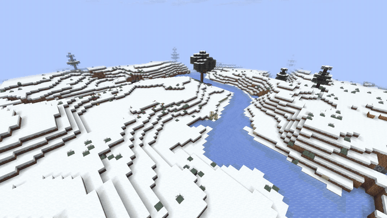

**Raid Bases** gives your wild a heartbeat. Every 45 minutes or so a bandit fort rises out of the ground somewhere in your world, and the whole server gets the news.

Players race there, fight through the guards, hold the vault until it cracks and grab the loot before their rivals do. Then the fort crumbles and the land it stood on comes back block for block, like it was never there.

No arena to build, no schematic to paste, no cleanup after. Raids build themselves, run themselves and clean up after themselves.

<Frame>
  
</Frame>

## What you get

- **11 fort layouts:** outpost, camp, hideout, keep, watchtower, castle, citadel, ziggurat, fortress, arena and bastion. Each one is generated from your palette with a little variation, so no two raids look quite the same.
- **4 tiers:** Outlaw Hideout, Bandit Stronghold, Warlord Fortress and Nightmare Bastion, each with its own guards, timers and loot.
- **Real fights:** guards hold their posts, the vault only opens once they are down, and the loot spills out for anyone close enough to grab it.
- **A clickable tracker:** `[Track]` in chat points an action-bar compass at the fort. A boss bar shows guards left, vault progress and time left to everyone nearby.
- **The land heals:** the area is saved to disk before the first block changes, put back when the raid ends, and checked block for block.
- **Crash-safe:** a raid cut short by a crash is put back on the next start.
- **WorldEvents hook:** a Blood Moon can raise a Nightmare fort near your players. You choose which events raise which tier.
- **Everything is configurable:** every timer, tier, guard, loot roll, sound, palette and message lives in `config.yml` and `messages.yml` (MiniMessage).

## Get Raid Bases

<CardGroup cols={2}>
  <Card title="Raid Bases PRO" icon="crown">
    Every tier, several raids at once, `/raid buy`, wall HP, your own `.schem` forts, money and command rewards, PlaceholderAPI. Licence key required. Store page coming soon.
  </Card>
  <Card title="Raid Bases Lite" icon="download">
    Free. One raid at a time on the first tier, all 11 layouts, the same safety and cleanup. Download coming soon.
  </Card>
</CardGroup>

| Feature | Lite | PRO |
| :-- | :---: | :---: |
| Forts, guards, vault, loot, land healing, crash safety | ✅ | ✅ |
| All 11 fort layouts | ✅ | ✅ + your `.schem` forts |
| Tiers | First tier | Every tier |
| Raids at once | 1 | `max-active` (3 by default) |
| `/raid buy`, wall HP, money and command rewards, PlaceholderAPI | ❌ | ✅ |
| Licence key | Not needed | Required |

See [Lite vs PRO](/raidbases/lite-vs-pro) for the full comparison.

## Compatibility

- **Server software:** Paper `1.20.6` through `26.3` (`api-version: 1.20.6`). Spigot and Folia are not supported.
- **Java:** 21 or newer. Paper 26.x servers need Java 25.
- **Required plugins:** none.
- **Optional:** Vault plus an economy plugin (PRO `/raid buy` and money rewards), PlaceholderAPI (PRO placeholders), WorldEvents Core or PRO (forts rise with its events).
- **PRO licence:** a key in `config.yml` and an internet connection for the licence check.

<Note>
On Paper 1.20.6 the vault block is behind an experimental flag, so the vault is a lodestone there unless the world has that flag on.
</Note>

## Quick commands

```text
/raid
/raid track
/raid start
/raid start here hard citadel
/raid list
/raid stop all
```

## Documentation sections

<CardGroup cols={2}>
  <Card title="Installation" icon="download" href="/raidbases/installation">
    Drop the jar, add your PRO key, start your first raid.
  </Card>
  <Card title="Lite vs PRO" icon="scale-balanced" href="/raidbases/lite-vs-pro">
    What each edition does, and how to upgrade.
  </Card>
  <Card title="How a raid plays out" icon="flag" href="/raidbases/raids">
    Rise, fight, crack, loot, collapse. Triggers, tracker and boss bar.
  </Card>
  <Card title="Forts and tiers" icon="chess-rook" href="/raidbases/forts-and-tiers">
    The 11 layouts, the 4 tiers and the palettes they are built from.
  </Card>
  <Card title="Defenses" icon="shield-halved" href="/raidbases/defenses">
    Guards, the vault, wall HP and what TNT can do.
  </Card>
  <Card title="Where forts rise" icon="map-location-dot" href="/raidbases/where-forts-rise">
    Site rules, the land journal and crash recovery.
  </Card>
  <Card title="Custom forts" icon="compass-drafting" href="/raidbases/custom-forts">
    PRO: raid your own WorldEdit `.schem` builds.
  </Card>
  <Card title="Buying and rewards" icon="coins" href="/raidbases/buying-and-rewards">
    PRO: `/raid buy`, money rewards and command rewards.
  </Card>
  <Card title="WorldEvents" icon="moon" href="/raidbases/worldevents">
    Raise a fort when a WorldEvents event starts.
  </Card>
  <Card title="Commands" icon="terminal" href="/raidbases/commands">
    `/raid` for players and admins.
  </Card>
  <Card title="Permissions" icon="key" href="/raidbases/permissions">
    Three nodes: player, buy and admin.
  </Card>
  <Card title="Configuration" icon="gear" href="/raidbases/configuration">
    Every key in `config.yml` and `messages.yml`.
  </Card>
  <Card title="Placeholders" icon="code" href="/raidbases/placeholders">
    PRO: PlaceholderAPI for scoreboards and tab lists.
  </Card>
  <Card title="FAQ" icon="circle-question" href="/raidbases/faq">
    Safety, missing raids, TNT, licences, schematics.
  </Card>
</CardGroup>

## Support

<Card title="Discord" icon="discord" href="https://discord.gg/kgHNjJsB2t">
  Claim your PRO key with `/claim RAIDBASES` and get support.
</Card>
