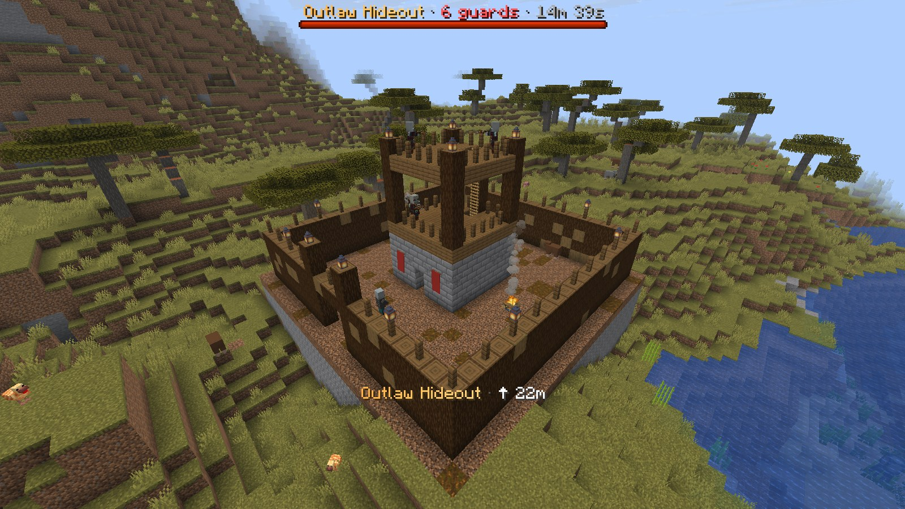
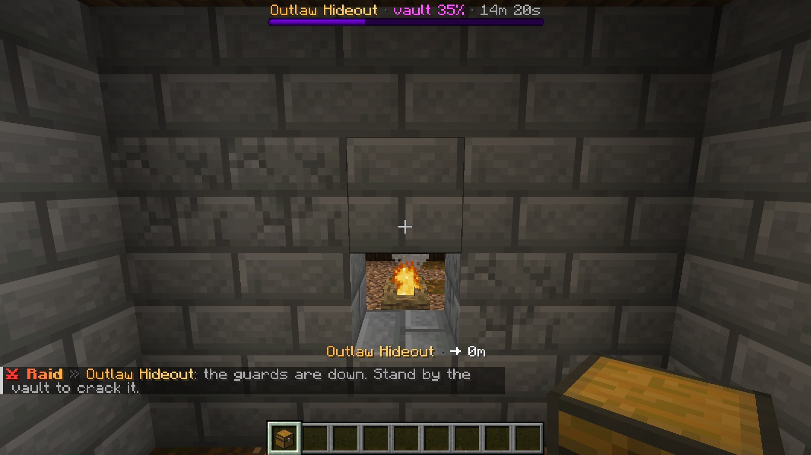

Every raid runs the same loop. The fort rises, the guards hold it, players clear them out, hold the vault until it cracks, grab the loot, and the fort comes down again.

<Frame>
  
</Frame>

## What starts a raid

| Trigger | Edition | How |
| --- | --- | --- |
| Schedule | Lite and PRO | About every `schedule.every-minutes` (45 by default), plus or minus `jitter-minutes` |
| Admin | Lite and PRO | `/raid start [here] [tier] [layout]` |
| WorldEvents | Lite and PRO | An event listed under `worldevents.events` starts. See [WorldEvents](/raidbases/worldevents) |
| Purchase | PRO | A player runs `/raid buy <tier>`. See [Buying and rewards](/raidbases/buying-and-rewards) |

A scheduled turn is skipped when fewer than `schedule.min-players` players are online (2 by default), or when the server already has as many raids as it allows. The schedule picks a tier by the weights in `schedule.tiers`. Lite always raises its first tier.

## The loop

<Steps>
  <Step title="The fort rises">
    Raid Bases finds a spot out in the wild and saves the land there to disk. Then the fort climbs out of the ground from the bottom up over `build.rise-seconds` (6 by default), foundations and all. Chat announces the tier and a rounded location with a clickable **[Track]**.
  </Step>
  <Step title="Fight the guards">
    When the fort is up, the guards spawn at their posts and chat says how many there are. The boss bar shows guards left and time left to everyone within `bossbar.range` blocks.
  </Step>
  <Step title="The vault unlocks">
    Once the guards alive drop to the tier's `unlock-guards-left` or fewer, chat says the vault is open.
  </Step>
  <Step title="Crack the vault">
    Stand within `vault.radius` blocks of the vault (4.5 by default). Progress fills by one second for every second someone is there. When nobody is there, it drains by the tier's `crack-decay` per second. The boss bar shows the percentage.
  </Step>
  <Step title="Grab the loot">
    At `crack-seconds` the vault bursts. The tier's loot spills out on the floor for anyone to grab, and chat names the player who cracked it. In PRO, every player at the vault also gets the tier's money and command rewards.
  </Step>
  <Step title="The land heals">
    After `loot-grace-seconds`, the fort comes down from the top with dust and a rumble over `build.collapse-seconds`. Raid Bases then checks every block against the saved land and fixes anything that still differs. Players stuck inside a block are lifted to the surface.
  </Step>
</Steps>

<Frame>
  
</Frame>

<Note>
More players at the vault do not crack it faster. Progress is shared, and one player holding it is enough. Chat names the player nearest the vault when it cracks, and in PRO everyone in range at that moment gets the rewards.
</Note>

## The time limit

Each tier has a `time-limit-minutes`. The clock starts when the guards spawn. If nobody cracks the vault in time, chat says the fort held out and it collapses with no loot.

## Raid phases

The boss bar, `/raid` and `/raid list` show each raid's phase.

| Phase | What is happening | Boss bar progress |
| --- | --- | --- |
| Rising | The fort is being built | How much is built |
| Guarded | Guards are up | Guards left |
| Vault open | Guards are down, the vault is cracking | Crack progress |
| Looted | The vault burst, grace time before the collapse | Grace time left |
| Collapsing | The land is being put back | How much is left |

Each phase has its own boss bar colour under `bossbar.colors` and its own text under `bar` in `messages.yml`.

While a fort is rising or collapsing, nobody can break or place blocks inside its area, and players take no fall damage there.

## Finding a raid

- **Chat:** the rising message names the world and a location rounded to `announce.round` blocks (25 by default), so players still have to scout.
- **`/raid`:** lists every standing raid with its tier, phase, and direction and distance from you.
- **`/raid track`:** points an action-bar compass at the nearest raid. Add an id to track a specific one. Run it again to turn it off. The **[Track]** button in chat does the same.
- **Boss bar:** appears for players within `bossbar.range` blocks of a fort (96 by default).

If you track a raid in another world, the action bar says which world it is in. When the raid ends, the tracker turns itself off.

## Stopping a raid

`/raid stop <id>` or `/raid stop all` sends a fort straight into its collapse. The land comes back the same way as after a normal raid.

A normal server stop puts the land under every standing fort back at once, before the plugin shuts down. A crash is handled on the next start. See [Where forts rise](/raidbases/where-forts-rise#crash-safe).
