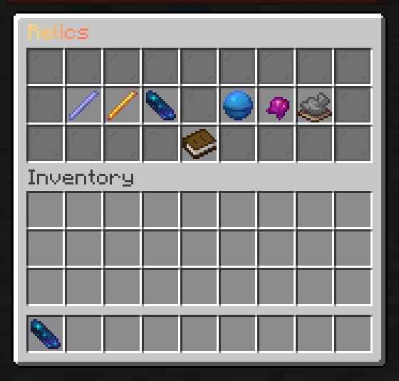

Everything runs through `/relics`. The alias is `/relic`. `<relic>` is a relic id: `storm`, `inferno`, `void`, `gravity`, `blood`, `orbital`, or a [custom relic](/relics-smp/custom-relics) id. Tab completion lists the relics your server runs.

Claiming a relic, casting its power and picking one up need no command and no permission.

## Players

| Command | Permission | Edition | What it does |
| --- | --- | --- | --- |
| `/relics` | `relics.use` | Lite and PRO | Open the relic board. From the console it prints help |
| `/relics help` | `relics.use` | Lite and PRO | Command help. Admins also see the admin commands |
| `/relics info <relic>` | `relics.use` | Lite and PRO | Where a relic is: at its altar, who holds it and where they were last seen, where it lies, or how long its offline holder has left |
| `/relics top` | `relics.use` | PRO | Top 10 hold times this season. See [Seasons](/relics-smp/seasons) |
| `/relics pro` | `relics.use` | Lite and PRO | On Lite, what PRO adds and a link. On PRO, confirms you're running PRO |

## Admins

| Command | Permission | Edition | What it does |
| --- | --- | --- | --- |
| `/relics admin` | `relics.admin` | Lite and PRO | Admin command help |
| `/relics admin setaltar <relic>` | `relics.admin` | Lite and PRO | Set the relic's altar at your feet. Players only |
| `/relics admin spawn <relic> [here]` | `relics.admin` | PRO | Drop a waiting relic now: at a random spot with the Relic Rain broadcast, or where you stand with `here` |
| `/relics admin give <relic> <player>` | `relics.admin` | PRO | Put a relic into an online player's inventory, wherever it was |
| `/relics admin reset <relic\|all>` | `relics.admin` | Lite and PRO | Send one relic, or every relic, back to its altar |
| `/relics admin season end` | `relics.admin` | PRO | Pay the season rewards, send every relic home and clear the leaderboard |
| `/relics admin reload` | `relics.admin` | Lite and PRO | Reload `config.yml` and `messages.yml` |

The console can run every command except opening the board, `setaltar` and `spawn <relic> here`.

PRO-only commands on Lite reply with `That's a Relics SMP PRO feature. See /relics pro.`

### Command notes

- `spawn` only works on a relic that is at home. Otherwise you see `That relic is already out. Reset it first.`
- `give` needs a free inventory slot. It doesn't announce anything
- `reset <relic>` announces the return in chat. `reset all` sends everything home quietly and confirms to you
- `reload` tells you how many values were invalid and fell back to defaults. From 1.1.0 it refuses a `config.yml` with a YAML error and changes nothing. Adding or removing custom relics still needs a restart. See [Configuration](/relics-smp/configuration#reloading)

## The relic board

`/relics` opens a read-only board with every relic on the server. Nothing can be taken out of it.

<Frame>
  
</Frame>

Each relic icon shows:

- **Status:** waiting at its altar, no altar set, held by a player, dropped on the ground, or its offline holder and the time left
- **Last seen:** the holder's last known spot and world
- **Active** with its cooldown, and **Passive**

A relic at its altar shows as gray dye. A relic that is out shows as its own item, with an enchant glint. The book explains the rules to new players.

On PRO, custom relics fill extra rows below the six built-ins, seven to a row. On Lite, admins see the four PRO relics as locked barrier icons. Set `hints.pro: false` to hide them.

**Admin actions.** Players with `relics.admin` can also act from the board:

| Click | Action |
| --- | --- |
| Left-click | Teleport to the relic: its holder, where it lies, or its altar |
| Shift + right-click | Send the relic back to its altar |

Change the slots and icon materials under `menu:` in `config.yml`. Change the title and lore in `messages.yml`. See [Configuration](/relics-smp/configuration#menu).
