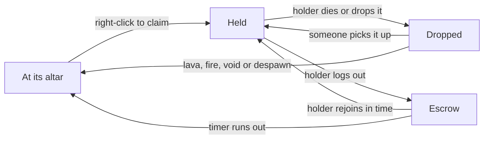
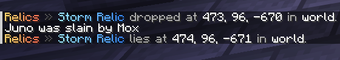

There is one copy of each relic on the server. It is always somewhere the server can see: at its altar, in one player's inventory, or on the ground. That's the whole game. Everyone knows who has it, and everyone can go take it.

## Where a relic can be

Each relic is always in one of four states. These are the values `%relics_state_<relic>%` returns in PRO.

| State | What it means |
| --- | --- |
| `altar` | Waiting at home. It floats over its altar until someone right-clicks it. No item exists |
| `held` | In an online player's inventory |
| `dropped` | A glowing item on the ground. Anyone can pick it up |
| `escrow` | The holder logged out. It's kept for them for `custody.offline-escrow-minutes` |



Admins can move a relic between states at any time with `/relics admin reset`, `give` and `spawn`. See [Commands](/relics-smp/commands).

## Claiming a relic

Right-click the floating relic at its altar with your main hand. The first click wins. You need a free inventory slot.

The whole server sees a chat line, and you get an on-screen title:

```text
Storm Relic was claimed by Steve. The hunt is on.
```

## Using a relic

**Active power.** Hold the relic in your main hand and right-click. Each relic has its own cooldown. The action bar shows the time left while it recharges.

- Right-clicking chests, doors, levers and other usable blocks still works normally. Sneak to cast at them instead
- The cooldown belongs to the relic, not the player. Passing a relic to someone else does not reset it
- If a power has nothing to hit, it fizzles and no cooldown starts. You see why: `Aim at a block in range.`, `No enemies in range.` or `No room to blink there.`

**Passive.** Works while the relic is anywhere in your inventory. Effects refresh every second and come off as soon as you lose the relic. You can carry more than one relic. Every passive you hold applies.

**Who powers hit.** Powers hit players and mobs. They never hit:

- You
- Your own tamed pets
- Armor stands
- Players in creative or spectator mode
- Players standing where PvP is off

Damage is credited to you, so other combat plugins see it as your hit. Damage and healing numbers in `config.yml` are in half-hearts: `4` is two hearts.

See [The six relics](/relics-smp/relics) for each power.

## Nowhere to hide

**Boss bars.** Every relic that is out (held, dropped or in escrow) gets a boss bar on every player's screen:

```text
⚡ Storm Relic · held by Steve
```

The bar drains toward the next reveal. Turn the bars off with `reveal.bossbar: false`.

**Timed reveals.** Every `reveal.interval-seconds` (default `300`, five minutes):

- Each holder glows for `reveal.glow-seconds` (default `10`)
- Their coordinates go to chat: `Storm Relic revealed: Steve at 120, 64, -340 in world.`
- Dropped relics have their spot posted too
- Everyone hears the reveal sound

Set `interval-seconds: 0` to turn timed reveals off.

**Last seen.** `/relics info <relic>` and the relic board show where each holder was last seen.

## Death, logout and drops

<Frame>
  
</Frame>

**Death.** Every relic you carry drops where you died, even with keepInventory on. The whole server sees where it fell. Die in the void and the relic goes straight home.

**Dropped relics.** A dropped relic glows. Mobs and hoppers can't pick it up, and it never merges with other items. If it burns in lava or fire, hits a cactus, gets blown up, falls into the void or despawns, it returns to its altar.

**Dropping it yourself.** With `custody.allow-drop: true` (the default), press Q to drop a relic. It becomes fair game for anyone. Set it to `false` and relics can't be dropped by hand.

**Logging out.** Your relic waits for you for `custody.offline-escrow-minutes` (default `10`). The boss bar shows the countdown. Rejoin in time and it's back in your inventory, or at your feet if your inventory is full. If you don't, it flies home to its altar.

**Restarts.** Relics survive restarts and chunk unloads. A relic that was held when the server stopped gets a fresh offline window from boot. One already waiting for an offline holder keeps its timer.

## No stashing

A relic only matters if someone can take it, so it stays on the player. These all refuse a relic:

- Any open container: chests, barrels, shulker boxes, ender chests, furnaces and the rest. Any click that would move a relic while a container is open is cancelled
- Bundles, item frames, armor stands and allays
- Blocks that take items: decorated pots, chiseled bookshelves, shelves, flower pots, composters, jukeboxes, lecterns and vaults
- Hoppers, hopper minecarts and dispensers
- The 2x2 crafting grid
- Placing the relic as a block

The player sees `Relics can't be stored. Keep it on you.` If a relic still turns up in a container, it's removed and sent home.

## Copies crumble

Every relic item carries a serial. Only the current serial counts, and the serial changes whenever the relic goes home, goes into escrow or is handed out again. Any other copy, from creative mode, a dupe or an old item, is deleted the moment it shows up in an inventory or container:

```text
A fake relic crumbled to dust.
```

Every second the plugin also checks that each holder has exactly one copy. Extra copies are removed. If the holder's copy goes missing for three seconds, the relic returns to its altar.

## Where powers work

Powers are blocked anywhere PvP is off. Relics can still be claimed, carried and revealed there. Only the powers stop.

| Setting | Default | What it does |
| --- | --- | --- |
| `protection.disabled-worlds` | `[]` | No powers at all in these worlds. Names are not case-sensitive |
| `protection.respect-world-pvp` | `true` | No powers in worlds with PvP turned off |
| `protection.spawn-radius` | `-1` | No powers within this many blocks of world spawn, in the main world only. `-1` uses `spawn-protection` from `server.properties`. `0` turns it off |
| `protection.respect-worldguard` | `true` | No powers in WorldGuard regions with `pvp` set to `deny`. Regions where the flag is unset count as allowed, like WorldGuard itself |

Three checks apply:

- **Where you stand.** If PvP is off there, you see `Relic powers don't work here.` and no cooldown starts
- **Where you aim.** Storm and Orbital targets, Void blink spots and custom `aim` and `blink` steps must be in a PvP area. Otherwise you see `You can't strike there.`
- **Who gets hit.** Players standing where PvP is off are never hit, even by a power cast from outside
