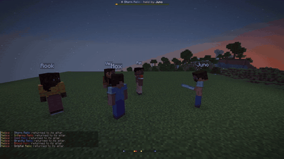

<Frame>
  
</Frame>

**Relics SMP** puts legendary relics on your server, and only one copy of each. Claim one from its altar and you get a right-click power and a passive buff. You also get a boss bar with your name on it, on every player's screen.

Every few minutes the holder glows and their coordinates go to chat. Kill them and the relic drops where they fell. Log out to hide and it waits for you, then flies home to its altar. Relics can't be stored, stashed or copied.

Gems plugins give everyone a gem. Relics SMP gives your server one.

## Get Relics SMP

### Relics SMP PRO

<Card title="BuiltByBit" icon="cart-shopping" href="https://builtbybit.com/resources/relics-smp-one-of-a-kind-power-relics.134621/">
  All six relics, Relic Rain, the WorldEvents PRO hook, seasons, PlaceholderAPI and admin give/spawn. Custom relics from PRO 1.1.0.
</Card>

<Note>
PRO needs a licence key. After you buy, join the [Discord](https://discord.gg/kgHNjJsB2t), run `/verify`, then `/claim RELICS_SMP`. Paste the key into `license_key` in `plugins/RelicsSMP/config.yml` and restart. See [Installation](/relics-smp/installation).
</Note>

### Relics SMP Lite (free)

<CardGroup cols={2}>
  <Card title="Modrinth" icon="download" href="https://modrinth.com/plugin/relics-smp-lite">
    Storm and Inferno relics with the full hunt.
  </Card>
  <Card title="SpigotMC" icon="download" href="https://www.spigotmc.org/resources/140148/">
    Storm and Inferno relics with the full hunt.
  </Card>
</CardGroup>

## What it does

- **One of each.** Every relic exists once on the whole server
- **Altars.** The relic floats over its altar with a beam until the first player right-clicks it
- **Nowhere to hide.** A boss bar names every holder. Timed reveals make holders glow and post their coordinates
- **Earned, not kept.** Relics drop where you die, even with keepInventory on
- **No logout cheese.** Log out with a relic and it waits 10 minutes, then goes home
- **No stashing.** Chests, ender chests, shulker boxes, hoppers, bundles, item frames and armor stands all refuse it. Copies crumble to dust
- **Fair fights.** Powers switch off where PvP is off: world PvP, WorldGuard regions, listed worlds and the spawn area
- **Relic board.** `/relics` shows every relic's status, holder, last-seen spot and cooldown
- **Yours to tune.** Every number in `config.yml`, every line in `messages.yml` (MiniMessage), plus every sound, particle, title and boss bar colour

## Lite vs PRO

| Feature | Lite (free) | PRO |
| --- | --- | --- |
| Relics | Storm, Inferno | Storm, Inferno, Void, Gravity, Blood, Orbital |
| [Custom relics](/relics-smp/custom-relics) | No | Up to 21 of your own (PRO 1.1.0+) |
| Altars, boss bars, timed reveals | Yes | Yes |
| Drops on death, offline return, no storing, copies crumble | Yes | Yes |
| Relic board (`/relics`) | Yes | Yes |
| [Relic Rain](/relics-smp/spawning#relic-rain) random drops | No | Yes |
| [WorldEvents PRO hook](/relics-smp/spawning#worldevents-pro-drops) | No | Yes |
| [Seasons](/relics-smp/seasons), `/relics top`, rewards | No | Yes |
| [PlaceholderAPI](/relics-smp/placeholders) | No | Yes |
| `/relics admin give` and `/relics admin spawn` | No | Yes |
| Licence key | Not needed | Required |

On Lite, admins see the four PRO relics as locked icons on the relic board. Turn that off with `hints.pro: false`. Players run `/relics pro` to see what PRO adds.

## Compatibility

- **Server software:** Paper. Tested on Paper **1.21.4** and **26.1**
- **Java:** 21 or newer, or whatever your Paper build needs
- **Dependencies:** none required
- **Optional:** WorldGuard (PvP regions), PlaceholderAPI (PRO placeholders), WorldEvents PRO (PRO event drops)
- **Not supported:** Spigot and Folia. The plugin uses Paper APIs and does not declare Folia support

## Quick commands

```text
/relics
/relics info storm
/relics admin setaltar storm
/relics admin reload
```

## Documentation sections

<CardGroup cols={2}>
  <Card title="Installation" icon="download" href="/relics-smp/installation">
    Jar, licence key, first altars and the files it writes.
  </Card>
  <Card title="How the hunt works" icon="crosshairs" href="/relics-smp/how-it-works">
    Claiming, powers, reveals, death drops, escrow and the no-stash rules.
  </Card>
  <Card title="The six relics" icon="wand-sparkles" href="/relics-smp/relics">
    Every active, passive and default number.
  </Card>
  <Card title="Custom relics" icon="flask" href="/relics-smp/custom-relics">
    PRO 1.1.0+. Build your own relics from ability steps.
  </Card>
  <Card title="Altars and Relic Rain" icon="cloud-bolt" href="/relics-smp/spawning">
    Altars, random drops, the WorldEvents PRO hook and admin spawn.
  </Card>
  <Card title="Seasons" icon="trophy" href="/relics-smp/seasons">
    PRO hold-time leaderboard and season rewards.
  </Card>
  <Card title="Commands" icon="terminal" href="/relics-smp/commands">
    `/relics`, the relic board and admin tools.
  </Card>
  <Card title="Permissions" icon="key" href="/relics-smp/permissions">
    `relics.use` and `relics.admin`.
  </Card>
  <Card title="Configuration" icon="gear" href="/relics-smp/configuration">
    Every key in `config.yml`, plus `messages.yml`.
  </Card>
  <Card title="Placeholders" icon="code" href="/relics-smp/placeholders">
    PRO PlaceholderAPI placeholders for holders, states and the leaderboard.
  </Card>
  <Card title="FAQ" icon="circle-question" href="/relics-smp/faq">
    Licence, editions, keepInventory, block damage and more.
  </Card>
</CardGroup>

## Support

<Card title="Discord" icon="discord" href="https://discord.gg/kgHNjJsB2t">
  Licence claims, questions and support.
</Card>
