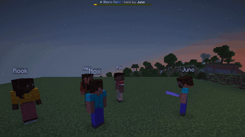
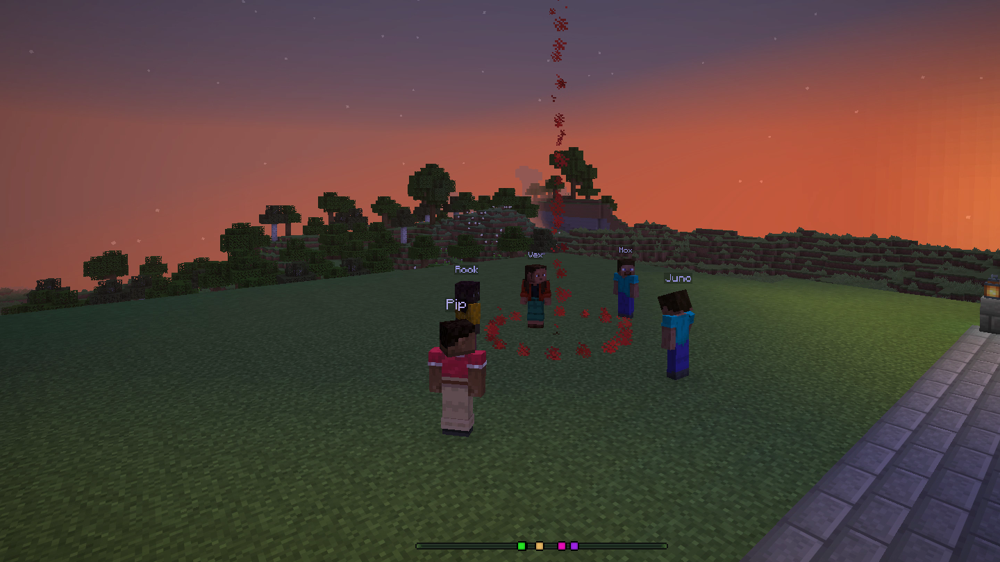

Every relic has a right-click **active** with its own cooldown and a **passive** that works while you carry it. Hover the relic in your inventory to see both on its tooltip.

Lite ships Storm and Inferno. PRO adds Void, Gravity, Blood and Orbital, and lets you [build your own](/relics-smp/custom-relics) from PRO 1.1.0.

All numbers below are the defaults from `config.yml`. Damage and healing are in half-hearts.

## ⚡ Storm Relic

**Lite and PRO.** Item: `BREEZE_ROD`. Boss bar: `YELLOW`.

- **Active:** a lightning barrage on the block you aim at. Five bolts land four ticks apart, scattered around the target. Each bolt hurts and knocks back enemies near it
- **Passive:** Speed I while carried
- **Cooldown:** 25 seconds

The lightning is visual only. It never starts fires or breaks blocks. Aim at the sky or past the range and you see `Aim at a block in range.` with no cooldown.

| Key | Default | Meaning |
| --- | --- | --- |
| `range` | `32` | How far you can aim, in blocks |
| `strikes` | `5` | Number of bolts |
| `spread` | `3` | How far from the target each bolt can land, in blocks |
| `radius` | `3` | Hit radius of each bolt |
| `damage` | `4` | Damage per bolt |
| `knockback` | `1.2` | Push away from each bolt |

## ♨ Inferno Relic

**Lite and PRO.** Item: `BLAZE_ROD`. Boss bar: `RED`.

- **Active:** a ring of fire rolls out from you. Every enemy it touches is hurt once, set on fire and blasted back
- **Passive:** Fire Resistance while carried
- **Cooldown:** 30 seconds

| Key | Default | Meaning |
| --- | --- | --- |
| `radius` | `8` | How far the ring rolls, in blocks |
| `damage` | `5` | Damage to each enemy |
| `fire-seconds` | `5` | How long they burn |
| `knockback` | `1.4` | Push away from you |

<Frame>
  
</Frame>

## ✧ Void Relic

**PRO.** Item: `ECHO_SHARD`. Boss bar: `PURPLE`.

- **Active:** blink forward along your look to the farthest open spot. Anyone near your trail gets Slowness II
- **Passive:** no fall damage while carried
- **Cooldown:** 12 seconds

The blink needs room for your whole body. Aiming a little down along the floor still works. With no room you see `No room to blink there.` and no cooldown starts.

| Key | Default | Meaning |
| --- | --- | --- |
| `distance` | `12` | Longest blink, in blocks |
| `slow-radius` | `2.5` | How close to the trail an enemy must be to get slowed |
| `slow-seconds` | `3` | How long the Slowness lasts |

## ◎ Gravity Relic

**PRO.** Item: `HEART_OF_THE_SEA`. Boss bar: `BLUE`.

- **Active:** pull every enemy nearby in toward you, then launch them straight up
- **Passive:** Jump Boost II and no fall damage while carried
- **Cooldown:** 30 seconds

Needs at least one enemy in range. Otherwise you see `No enemies in range.` and no cooldown starts.

| Key | Default | Meaning |
| --- | --- | --- |
| `radius` | `10` | Pull radius, in blocks |
| `pull` | `1.1` | Pull strength |
| `launch` | `1.4` | Upward launch strength |
| `launch-delay-ticks` | `12` | Ticks between the pull and the launch |

## ❤ Blood Relic

**PRO.** Item: `FERMENTED_SPIDER_EYE`. Boss bar: `RED`.

- **Active:** drain 4 hearts, split evenly across every enemy nearby, and heal yourself by what you took
- **Passive:** lifesteal. Your melee hits heal you by 15% of the damage dealt
- **Cooldown:** 35 seconds

Needs at least one enemy in range. Lifesteal only counts melee hits, not damage from relic powers.

| Key | Default | Meaning |
| --- | --- | --- |
| `radius` | `8` | Drain radius, in blocks |
| `drain` | `8` | Total health drained, shared between all enemies |

The passive is `passive.lifesteal-percent: 15`.

## ☄ Orbital Relic

**PRO.** Item: `NETHER_STAR`. Boss bar: `WHITE`.

- **Active:** mark a block. A red warning beam and ring light it up for a few seconds while a ping sounds. Then a column of blasts slams down on it
- **Passive:** Resistance I while carried
- **Cooldown:** 60 seconds

The blasts only hurt entities. They break blocks only when you set `abilities.break-blocks: true`.

| Key | Default | Meaning |
| --- | --- | --- |
| `range` | `48` | How far you can aim, in blocks |
| `warning-seconds` | `3` | How long the warning beam shows |
| `blasts` | `4` | Number of blasts in the column |
| `radius` | `4` | Hit radius of each blast |
| `damage` | `10` | Damage per blast |

<Frame>
  
</Frame>

## Tune a relic

Every relic lives under `relics:` in `config.yml`. This is the Storm Relic as shipped:

```yaml title="plugins/RelicsSMP/config.yml"
relics:
  storm:
    material: BREEZE_ROD
    bossbar-color: YELLOW
    cooldown-seconds: 25
    passive:
      effects: ["SPEED:0"]
    ability:
      range: 32
      strikes: 5
      spread: 3
      radius: 3
      damage: 4
      knockback: 1.2
```

| Key | What it does |
| --- | --- |
| `material` | The relic's item, as a Bukkit material name. An invalid name falls back to the shipped item |
| `bossbar-color` | `PINK`, `BLUE`, `RED`, `GREEN`, `YELLOW`, `PURPLE` or `WHITE` |
| `cooldown-seconds` | Seconds between casts. Must be above 0 |
| `passive.effects` | Potion effects while carried, as `NAME` or `NAME:amplifier`. Amplifier `0` is level I, up to `9` |
| `passive.no-fall-damage` | `true` cancels fall damage while carried |
| `passive.lifesteal-percent` | Percent of melee damage that heals you, `0` to `100` |
| `ability.*` | The power's numbers from the tables above. Each must be above 0 |

Any relic can use any passive key. You could give Storm lifesteal or Orbital no fall damage. Effect names are Minecraft ids such as `SPEED`, `JUMP_BOOST`, `FIRE_RESISTANCE`, `RESISTANCE`, `STRENGTH` or `SLOWNESS`.

A bad value never stops the plugin. It falls back to the shipped default and the console names the key. `/relics admin reload` tells you how many values were ignored. A material or effect name the server doesn't know is skipped without a console line: the relic uses its shipped item, and the effect doesn't apply.

Relic names, symbols and the active and passive lines on the tooltip live in `messages.yml` under `relic.<id>`. See [Configuration](/relics-smp/configuration#messages).
