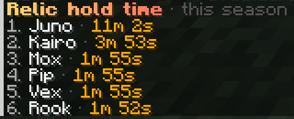

<Note>
Seasons are a **PRO** feature. On Lite, `/relics top` and `/relics admin season end` reply with `That's a Relics SMP PRO feature.`
</Note>

Every second a player holds a relic counts. The longer you keep it from the rest of the server, the higher you climb. When you end the season, the top holders get your rewards and the hunt starts fresh.

## Hold time

- Each relic adds one second per second to its holder while they are online and carrying it
- Holding two relics counts twice as fast
- Time in offline escrow does not count
- Custom relics count the same as the built-ins

Hold times are saved to `plugins/RelicsSMP/stats.yml` every minute and on shutdown, so they survive restarts.

## Leaderboard

`/relics top` shows the ten players with the most hold time this season:

<Frame>
  
</Frame>

Times read like `11m 2s` or `1h 5m`. Ties are sorted by name, so the board never flickers. For scoreboards and tab lists, use the [placeholders](/relics-smp/placeholders) `%relics_top_<n>%`, `%relics_top_<n>_time%` and `%relics_held_time%`.

## End a season

Seasons end when you say so. Run:

```text
/relics admin season end
```

This:

1. Runs your reward commands for each place you configured, from the console
2. Sends every relic back to its altar
3. Clears the leaderboard
4. Announces `Season over!` in chat, with a title and a sound for everyone

## Rewards

```yaml title="plugins/RelicsSMP/config.yml"
seasons:
  rewards:
    '1':
      - "give %player% netherite_ingot 2"
    '2':
      - "give %player% diamond_block 3"
    '3':
      - "give %player% diamond 16"
```

- Each key is a leaderboard place. Use any positive whole number, so you can reward the top 5 or the top 10
- Each place takes a list of console commands. `%player%` becomes the player's name
- A place nobody reached is skipped
- Keys that aren't positive whole numbers are ignored with a console warning

Use any command another plugin gives you, such as crate keys, ranks or money.
