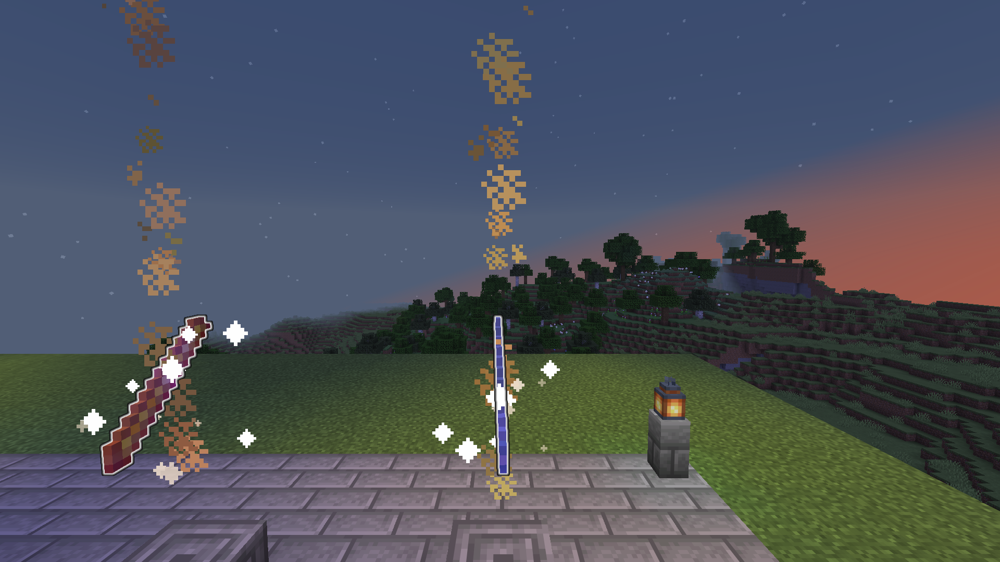
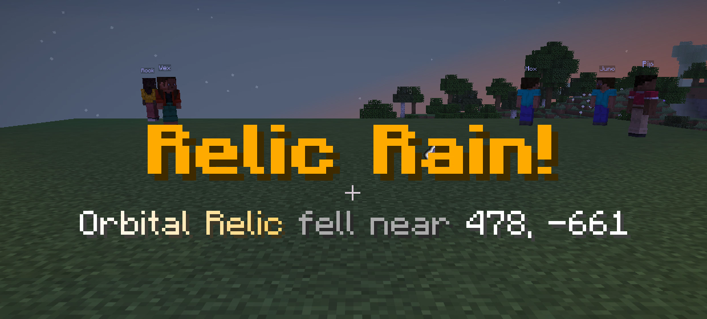

Relics start at home. Where home is, and how they leave it, is up to you.

## Altars

Stand where a relic should live and run:

```text
/relics admin setaltar storm
```

The altar goes at your feet. While the relic waits there, it floats above the spot, spinning, with a glowing outline and a gold beam. The first player to right-click it claims it.

<Frame>
  
</Frame>

- Run the command again anywhere to move an altar
- A relic with no altar shows **No altar set** on the relic board. It can't be claimed from an altar until you set one
- The floating relic and its hitbox are not saved into the world. They are rebuilt whenever the altar's chunk is loaded, so a crash never leaves stray copies behind
- The beam uses the `altar-beam` and `altar-sparkle` particles in `config.yml`

Every relic that goes home (from escrow, a reset, the void, lava or a season end) comes back to its altar and waits for the next claim.

## Relic Rain

**PRO.** Switch spawning to random and relics stop waiting politely. Every interval, each relic sitting at home drops at a random spot on the map, with a broadcast, a title and a thunder sound. The whole server starts running.

<Frame>
  
</Frame>

```yaml title="plugins/RelicsSMP/config.yml"
spawning:
  mode: random
  random:
    world: world
    center-x: 0
    center-z: 0
    radius: 1000
    interval-minutes: 30
```

| Key | Default | What it does |
| --- | --- | --- |
| `spawning.mode` | `altar` | `altar`: relics wait at their altar for a claim. `random`: relics at home also rain down every interval |
| `spawning.random.world` | `world` | World the relics drop in. If it doesn't exist, the server's first world is used |
| `spawning.random.center-x` | `0` | Centre of the drop circle |
| `spawning.random.center-z` | `0` | Centre of the drop circle |
| `spawning.random.radius` | `1000` | Radius of the drop circle, in blocks |
| `spawning.random.interval-minutes` | `30` | Minutes between rains. `0` stops the timer |

How it works:

- Only relics at home rain. Held, dropped and offline relics are left alone
- Altars still work in random mode. A relic at its altar can be claimed until the next rain takes it
- The spot is the surface at a random point inside the circle. Water, lava, bedrock, cactus, magma and fire are skipped. After 12 failed tries, that relic waits for the next rain
- A rained relic is a normal dropped relic: it glows and anyone can grab it
- The timer starts from boot and restarts on `/relics admin reload`

Chat shows `Relic Rain! Orbital Relic fell near 478, -661 in world.` Everyone sees the **Relic Rain!** title and hears the `rain` sound.

Lite ignores `mode: random`. Relics wait at their altars.

## WorldEvents PRO drops

**PRO.** Running [WorldEvents PRO](https://builtbybit.com/resources/worldevents-pro-scheduled-events.88756)? When one of its events starts, one random relic that is waiting at home drops at a random spot. It uses the same circle and safe-spot rules as Relic Rain. This works in both `altar` and `random` mode.

```yaml title="plugins/RelicsSMP/config.yml"
spawning:
  worldevents:
    enabled: true
    events: []
```

| Key | Default | What it does |
| --- | --- | --- |
| `spawning.worldevents.enabled` | `true` | Turn the hook on or off |
| `spawning.worldevents.events` | `[]` | Only these events drop a relic. Match the event id or its name, not case-sensitive. Empty means any event |

WorldEvents PRO must be enabled when Relics SMP starts. The console confirms the hook with `Hooked into WorldEvents PRO: events can drop relics.` Without WorldEvents PRO, nothing happens and nothing breaks.

## Admin tools

| Command | Edition | What it does |
| --- | --- | --- |
| `/relics admin spawn <relic>` | PRO | Drop a waiting relic at a random spot now, with the Relic Rain broadcast and title |
| `/relics admin spawn <relic> here` | PRO | Drop a waiting relic where you stand |
| `/relics admin give <relic> <player>` | PRO | Put a relic straight into an online player's inventory, wherever it was |
| `/relics admin reset <relic>` | Lite and PRO | Send a relic home to its altar, wherever it is |
| `/relics admin reset all` | Lite and PRO | Send every relic home |

`spawn` only works on a relic that is at home. If it's out, you see `That relic is already out. Reset it first.` `give` needs a free slot in the player's inventory. See [Commands](/relics-smp/commands).
