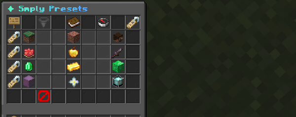

## Requirements

- **Server software:** Paper or Folia `1.20.6` through `26.1.2`
- **Java:** Java 21 for 1.20.6–1.21.x; Java 25 for 26.1+.
- **License:** A paid Smply license key (product id `SMPLY`)
- **Optional:** Vault + an economy plugin, LuckPerms, PlaceholderAPI, TAB

Folia support is partial. `/smply doctor` detects the host, but does not verify simultaneous heart/quest changes or reloads across regions. Check those workflows with your exact release before opening a Folia server.

## Install Smply

1. Stop your server.
2. Place `Smply-1.0.0.jar` in the `plugins` folder.
3. Start the server once so Smply writes its config files. First boot is **Vanilla+**.
4. Stop the server again.
5. Open `plugins/Smply/config.yml`.
6. Replace `YOUR_KEY_HERE` with your license key.
7. Start the server.

```yaml title="plugins/Smply/config.yml"
license_key: "MATT-XXXX-XXXX"
```

Verification runs on startup. `/smply reload` does not re-check the key. An invalid or missing key disables the plugin.

## Claim your license

Join the support Discord and claim the `SMPLY` product license (for example `/claim SMPLY`). Paste the generated key into `config.yml` before running in production.

<Card title="Join Discord" icon="discord" href="https://discord.gg/kgHNjJsB2t">
  Claim your license key and get support.
</Card>

## Pick a preset

Stand in-game (or use console) and apply the niche you are launching:

```text
/smply preset lifesteal
```

That turns on Lifesteal modules and merges the bundled blueprint (hearts, combat, HUD, kits, quests).

Keep your existing YAML and only flip modules:

```text
/smply preset lifesteal --modules-only
```

Restore official overlay values after you have customized files:

```text
/smply preset lifesteal --reset
```

Other presets: `economy_smp`, `boxsmp`, `creator_smp`, `full_suite`. `vanilla_plus` is already the default. See [Presets](/smply/presets).

<Frame>
  
</Frame>

## Set spawn

Stand where players should spawn, then:

```text
/setspawn
```

## Open the hub

```text
/hub
```

or `/smply menu`. Players land on a 27-slot hub named after `server_name` in `config.yml`.

## First checks

```text
/smply doctor
/smply validate
```

`/smply doctor` is the launch check (spawn, Vault, LuckPerms, claims, HUD). `/smply validate` is schema-only. For support tickets, paste `/smply status paste`.

## Recommended stack

Smply is the SMP core you center the server on. You still install:

| Plugin | Role |
| --- | --- |
| LuckPerms | Permissions, home limits, rank kits |
| Vault + economy plugin | Paid sell, auction, shop, and bounty charges |
| Claims (GriefPrevention, SimpleClaimSystem, or similar) | Land protection. Optional on griefable Lifesteal |
| PlaceholderAPI | `%smply_*%` for TAB and scoreboards |
| TAB | Full tablist. Smply defers and feeds placeholders |
| CoreProtect | Rollback. Smply does not write those logs |

There is no Essentials or CMI data import. Treat this as a fresh world relaunch.

## Next steps

- Tune `kits.yml`, `rewards.yml`, `hud.yml`, and `messages.yml`
- Enable auction and shop with the `economy_smp` preset, or turn those modules on in `config.yml`
- If you keep Essentials for economy only, disable its overlapping travel commands. See [Integrations](/smply/integrations)

## Updates and support

Keep your existing configuration and data when replacing the JAR. Follow [Updating and getting help](/maintenance) for backups, restart checks and the details to include in a support ticket.
