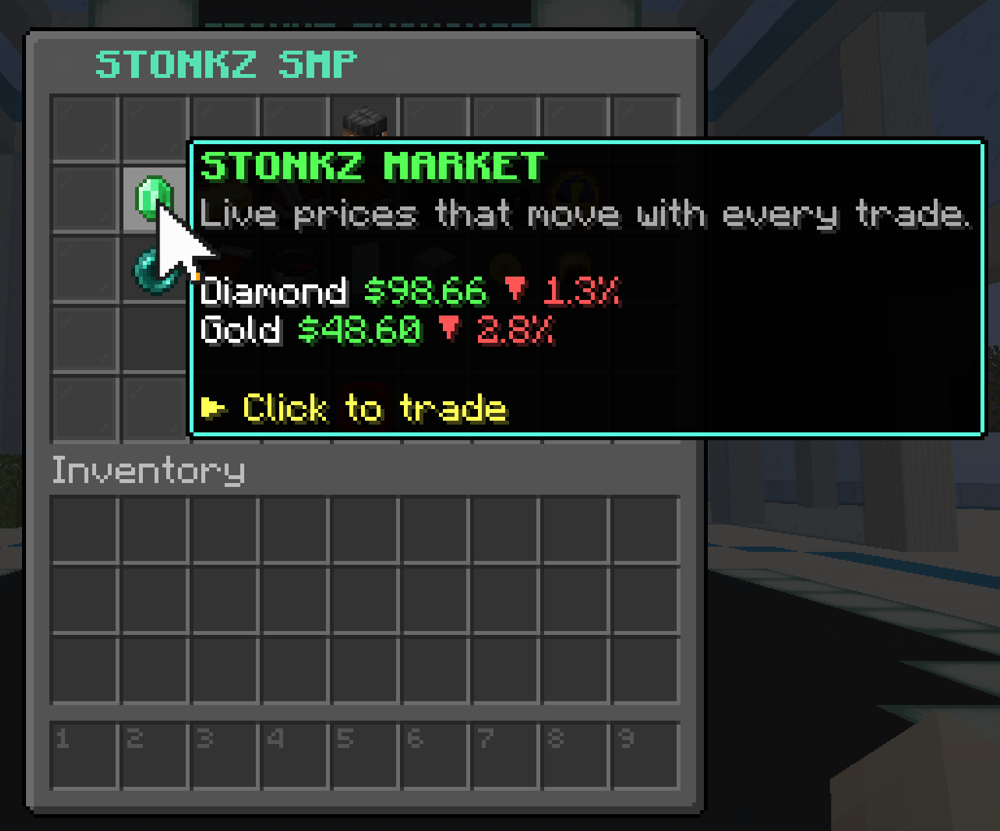

This page covers the commands your players and staff use day to day. Each bundled plugin has more commands of its own. See its docs for the full list.

## Player commands

Every player can use these from the first join.

| Feature | Commands |
| --- | --- |
| Main menu | `/menu` |
| Stock market | `/shop`, `/sell`, `/sellall`, `/sellhand`, `/worth <item>`, `/portfolio` |
| Auction house | `/ah` |
| Buy orders | `/orders` |
| Spawners | `/spawnershop`, `/3ts` |
| World events | `/wevent`, `/wevent list` |
| Seasons | `/season`, `/leaderboard` |
| Random teleport (Overworld, Nether, End) | `/rtp` |
| Teams | `/team` |
| Bounties | `/bounty` |
| Crates | `/crates` |
| Homes and travel | `/sethome`, `/home`, `/spawn`, `/back`, `/tpa`, `/tpaccept` |
| Money | `/balance`, `/pay`, `/baltop` |

<Frame>
  
</Frame>

### Market shortcuts

`/shop` and `/worth` are shortcuts set in the server's `commands.yml`:

| You type | It runs |
| --- | --- |
| `/shop` | `/stonkz` (opens the market) |
| `/worth <item>` | `/stonkz price <item>` |

`/sellall` is Stonkz's own alias for `/sellinv`. It sells everything sellable in your inventory. `/sellhand` sells the stack in your hand.

## Owner commands

Run these as an operator or as a member of the `admin` rank.

### Seasons

```text
/season start
/season stop
/season next
/season settime <time>
/season grace <on|off|auto|status>
/season backup [label]
/season reload
```

`settime` takes a duration like `10m`, `1h` or `7d`. See [Seasons](/stonkz-smp/seasons) for what each step does.

### Crates

```text
/crates give virtual <Common|Rare|Stonkz> <amount> <player>
/crates reload
```

### Ranks

```text
lp user <player> parent set <vip|mvp|admin>
lp editor
```

Run these in the console, or in game with a leading `/`. See [Ranks](/stonkz-smp/ranks).

### Reloads

| Command | Reloads |
| --- | --- |
| `/tab reload` | Scoreboard and tab list |
| `/dm reload` | The `/menu` main menu |
| `/crates reload` | Crates |
| `/season reload` | Season settings |

<Warning>
Do not use Bukkit `/reload`. Restart the server, or use a plugin's own reload command. A restart is the safest option after you change several configs.
</Warning>

## Full command lists

<CardGroup cols={2}>
  <Card title="3TSpawner commands" icon="terminal" href="/3tspawner/commands">
    Spawner shop, storage, sell and admin tools.
  </Card>
  <Card title="SeasonManager commands" icon="calendar" href="/seasonmanager/commands">
    Season control and stats.
  </Card>
</CardGroup>
