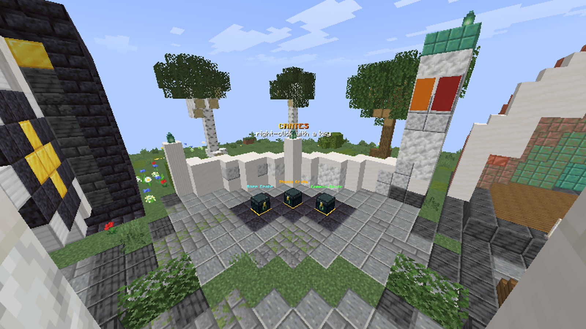

Stonkz SMP has three crate tiers at spawn, run by CrazyCrates. Players earn Common keys in the AFK Lounge, and better keys drop from the crates themselves.

<Frame>
  
</Frame>

## Opening a crate

Right-click a crate at spawn with a key. Keys are **virtual**: they live on your account, not in your inventory. `/crates` opens the crate menu, which shows how many keys you have.

Each crate rolls a spinning prize animation, and players can preview the prizes before they open one.

## Prizes

### Common crate

| Prize | Chance |
| --- | --- |
| $1,000 | 26.1% |
| 16 Iron Ingots | 17.4% |
| $2,500 | 13% |
| 8 Gold Ingots | 13% |
| 16 Golden Carrots | 13% |
| 3 Diamonds | 8.7% |
| Diamond Pickaxe | 5.2% |
| Rare Crate Key | 3.5% |

### Rare crate

| Prize | Chance |
| --- | --- |
| $10,000 | 25% |
| 16 Diamonds | 15% |
| Diamond Sword | 12% |
| $25,000 | 10% |
| Mending Book | 10% |
| Totem of Undying | 10% |
| 2 Netherite Ingots | 8% |
| Zombie Spawner | 7% |
| Stonkz Crate Key | 3% |

### Stonkz crate

| Prize | Chance |
| --- | --- |
| $50,000 | 25% |
| 32 Diamonds | 22% |
| 3 Totems of Undying | 14% |
| 4 Netherite Ingots | 12% |
| $100,000 | 8% |
| Iron Golem Spawner | 8% |
| Elytra | 7% |
| Blaze Spawner | 4% |

Spawner prizes are real 3TSpawner spawners, the same ones sold in the Spawner Vault.

## Giving keys

Give keys from the console or in game as an admin:

```text
/crates give virtual <Common|Rare|Stonkz> <amount> <player>
```

For example, `/crates give virtual Rare 3 Steve` gives Steve three Rare keys. Use it for vote rewards, events or store purchases.

## Editing crates

Each crate is one file in `plugins/CrazyCrates/crates/`:

- `Common.yml`
- `Rare.yml`
- `Stonkz.yml`

Each prize has a `Weight`. The chance is its weight divided by the total weight of the crate. Update the `Chance:` line in the prize's lore when you change a weight, so players see the right odds. Run `/crates reload` after editing.

## AFK Lounge

The AFK Lounge is a cherry-blossom pergola at spawn. Stand inside it and a green boss bar counts down to your next reward.

Every **5 minutes** in the lounge, a player gets one of:

| Reward | Chance |
| --- | --- |
| $500 | 85% |
| Common Crate Key | 15% |

The lounge is an AxAFKZone zone. Edit it in `plugins/AxAFKZone/zones/afk-lounge.yml`:

```yaml title="plugins/AxAFKZone/zones/afk-lounge.yml"
reward-time-seconds: 300
rewards:
  - chance: 85.0
    display: "&a$500"
    commands:
      - "eco give %player% 500"
  - chance: 15.0
    display: "&aCommon Crate Key"
    commands:
      - "crazycrates give virtual Common 1 %player%"
```
