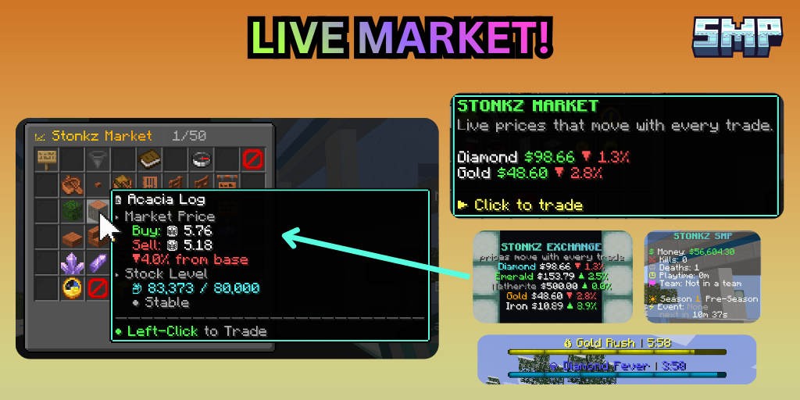
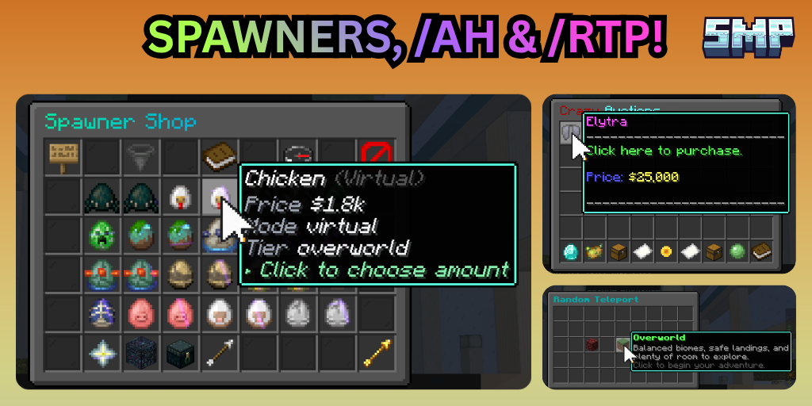

The Stonkz SMP economy is built so money keeps its value all season. Prices move with supply and demand, and spawner farms feed the same market as everyone else.

## The player loop

1. `/rtp` into the wild and start mining or farming.
2. `/sell` or `/sellall` to the market. The price moves with each sale.
3. Save up and buy a spawner from the Spawner Vault.
4. Sell the spawner loot. It sells at the live market price, so a big farm pushes its own price down.
5. Trade with other players on `/ah` and `/orders`, and climb `/baltop` before the season ends.

New players start with $0.

## The live market

<Frame>
  
</Frame>

The market is Stonkz. Every item has a stock level and a price that answers to it:

- **Buying** drains stock and lifts the price.
- **Selling** floods stock and cuts the payout.
- **Panic Mode:** when players rush to sell an item, its price drops to half for 5 minutes and buying it is paused.
- **Market events** such as Gold Rush, Diamond Fever and Lumber Boom shake prices on their own.
- **Random drift:** every 10 minutes, about 20% of items move by up to 5%.

Players open it with `/shop`, the Market Broker NPC at spawn, or the emerald in `/menu`.

| Command | What it does |
| --- | --- |
| `/shop` | Open the market |
| `/sell <item> <amount>` | Sell an item |
| `/sellall` | Sell everything sellable in your inventory |
| `/sellhand` | Sell the stack in your hand |
| `/worth <item>` | Check an item's price |
| `/buy <item> <amount>` | Buy an item |
| `/portfolio` | Your trades, profit and loss |

Limit orders and short selling are on too. See the [Stonkz listing](https://builtbybit.com/resources/84623/) for every market feature.

## Automatic starting prices

The included Stonkz build has recipe-aware starting prices. In `plugins/Stonkz/config.yml`, keep `market.auto_populate_items: true`. It runs on startup; after a config change, run `/stonkz reload`, then `/stonkz admin populate` to run it now.

You do not need to enter every recipe price manually. The scan adjusts eligible default prices and keeps owner-customized pricing. Back up your plugin folder and database first. Do not apply a fresh preset or clear the market just to enable it: those actions replace your listings.

Check the console for the balancing summary and any remaining profitable routes. Live prices still move with trades and events; other shops and custom recipes need separate checks. See [Stonkz automatic pricing](https://mbaconz.gitbook.io/stonkz/admin-guide/automatic-pricing) for the full procedure.

## Spawners

<Frame>
  
</Frame>

Spawners come from 3TSpawner. `/spawnershop` or the Spawner Vault NPC opens the shop:

- **27 mobs**, from a $1,800 chicken spawner to a $500,000 warden spawner
- **Physical** spawners you place, or **virtual** spawners that run without a block
- **Storage, sell and collect** from one menu with `/3ts`
- **Loot sells at the live Stonkz price**, so spawner income follows the market

| Limit | default | VIP and up |
| --- | --- | --- |
| Spawners per stack | 64 | 128 |
| Virtual spawners | 250 | 500 |

See the [3TSpawner docs](/3tspawner/index) for upgrades, clusters and storage.

## Auction house

`/ah` opens CrazyAuctions. Players list items for a price and buy from each other. The number of listings depends on rank: 3 for default, 6 for VIP and 10 for MVP.

## Buy orders

`/orders` opens Orderium. A player posts what they want and the price they will pay. Other players fill the order and get paid.

## Teams

`/team` opens UltimateTeams. Teams get team homes, warps, team chat, a shared ender chest, up to 4 allies and 2 enemies. Teams hold up to 8 members, and friendly fire is off in new teams. The player's team name shows on the scoreboard.

## Bounties

`/bounty` lets players put money on someone's head. The smallest bounty is $10. The player who gets the kill collects it.

## Combat tag

EternalCombat tags players for 20 seconds after a hit. Quitting while tagged counts as a combat log and is punished, and ender pearls are blocked during combat. Settings are in `plugins/EternalCombat/config.yml`.

## Homes, travel and money

| Command | What it does |
| --- | --- |
| `/sethome <name>`, `/home` | Set and use homes (3, 5 or 10 by rank) |
| `/tpa <player>` | Ask to teleport to a player |
| `/back` | Return to your last location or death point |
| `/spawn` | Go to the Stonkz Exchange |
| `/pay <player> <amount>` | Send money |
| `/baltop` | Richest players |

## Not included

There is no shards or second currency. The AFK Lounge pays money or a Common crate key instead. See [Crates and AFK](/stonkz-smp/crates-and-afk).
