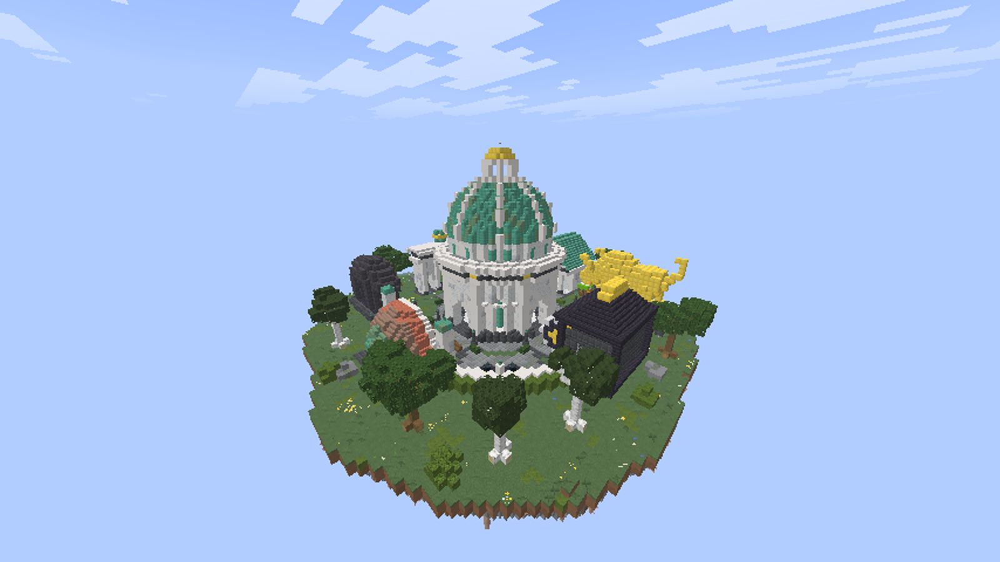

**Stonkz SMP** is a complete Donut-style Economy SMP, packed as one zip. Copy it into a Paper server, paste your licence keys, and open. Everything is already configured to work together: a live stock-market economy, spawners, world events, 30-day seasons, an auction house, buy orders, crates, teams, bounties, an AFK lounge and a custom spawn called the **Stonkz Exchange**.

<Frame>
  
</Frame>

## Why it works

Most economy servers run on a static shop. One player builds the best farm, sells into a shop that pays forever, and by week two everyone is rich.

Stonkz SMP runs on a market that pushes back:

- **Prices move.** Buying drains stock and lifts the price. Selling floods it and cuts the payout.
- **Panic Mode.** A sell rush on one item halves its price for 5 minutes.
- **Spawner loot sells at live prices.** Big farms move the board instead of printing money.
- **Something is always happening.** World events roll in every 30 minutes, on top of a weekly calendar.
- **A finish line.** 30-day seasons with stats, a countdown and a leaderboard.

## What you get

<CardGroup cols={2}>
  <Card title="Four premium plugins" icon="gem" href="/stonkz-smp/whats-inside">
    Stonkz, 3TSpawner, WorldEvents PRO and SeasonManager PRIME, keys included.
  </Card>
  <Card title="The Stonkz Exchange" icon="landmark" href="/stonkz-smp/spawn">
    A floating-island spawn with live price boards, NPCs, crates and an AFK lounge.
  </Card>
  <Card title="Donut-style features" icon="store" href="/stonkz-smp/economy">
    `/ah`, `/orders`, spawners, `/rtp`, teams, bounties, homes and combat tag.
  </Card>
  <Card title="Ranks and branding" icon="crown" href="/stonkz-smp/ranks">
    VIP, MVP and Admin ranks, a scoreboard, a tab list and one-click rebranding.
  </Card>
</CardGroup>

## Try it

Join the live demo server at `play.stonkz.space` to walk around the Exchange and try the market before you buy.

## Get Stonkz SMP

<CardGroup cols={2}>
  <Card title="Discord" icon="discord" href="https://discord.gg/kgHNjJsB2t">
    Claim your four licence keys and get support.
  </Card>
  <Card title="Stonkz on BuiltByBit" icon="chart-line" href="https://builtbybit.com/resources/84623/">
    The market plugin at the heart of the setup.
  </Card>
</CardGroup>

The Stonkz SMP store link is added here when the store page is live.

## Compatibility

| Component | Requirement |
| --- | --- |
| Server software | Paper **26.1.2** (not included, [download from PaperMC](https://papermc.io/downloads/paper)) |
| Java | **25** |
| RAM | 4 GB or more |
| Licence keys | 4 keys from Discord, plus internet access for the licence checks |
| Current version | **1.0.1** (ships Stonkz 1.4.45) |

<Warning>
Use Paper 26.1.2. The bundled plugins are pinned to that version. Folia is not supported: several bundled plugins, such as EssentialsX and WorldGuard, do not run on Folia.
</Warning>

## Quick start

<Steps>
  <Step title="Rebrand">
    On Windows, double-click `rebrand.bat` and type your server's name and address. See [Rebranding](/stonkz-smp/rebranding).
  </Step>
  <Step title="Copy the server folder">
    Copy everything from the package's `server` folder into your server's root folder. See [Installation](/stonkz-smp/installation).
  </Step>
  <Step title="Add your keys">
    Claim four keys in Discord and paste them into the plugin configs. See [Licence keys](/stonkz-smp/licence-keys).
  </Step>
  <Step title="Open">
    Restart, run `lp user <your name> parent set admin` in the console, then `/season start`.
  </Step>
</Steps>

## Documentation sections

<CardGroup cols={2}>
  <Card title="What's inside" icon="box-open" href="/stonkz-smp/whats-inside">
    Every plugin in the zip and what it does.
  </Card>
  <Card title="Installation" icon="download" href="/stonkz-smp/installation">
    Requirements, copy steps, first boot and admin.
  </Card>
  <Card title="Licence keys" icon="key" href="/stonkz-smp/licence-keys">
    `/verify`, `/claim` and where each key goes.
  </Card>
  <Card title="Updating" icon="arrows-rotate" href="/stonkz-smp/updating">
    Move from 1.0 to 1.0.1.
  </Card>
  <Card title="Commands" icon="terminal" href="/stonkz-smp/commands">
    Player and owner commands at a glance.
  </Card>
  <Card title="Ranks" icon="crown" href="/stonkz-smp/ranks">
    Default, VIP, MVP and Admin perks.
  </Card>
  <Card title="Configuration" icon="gear" href="/stonkz-smp/configuration">
    Where to change prices, events, crates, seasons and more.
  </Card>
  <Card title="Rebranding" icon="tag" href="/stonkz-smp/rebranding">
    Your name on the scoreboard, tab list and menu.
  </Card>
  <Card title="Spawn" icon="landmark" href="/stonkz-smp/spawn">
    The Stonkz Exchange, its NPCs and price boards.
  </Card>
  <Card title="Economy" icon="coins" href="/stonkz-smp/economy">
    Market, spawners, auction house and buy orders.
  </Card>
  <Card title="Crates and AFK" icon="box" href="/stonkz-smp/crates-and-afk">
    Three crate tiers and the AFK Lounge.
  </Card>
  <Card title="World events" icon="bolt" href="/stonkz-smp/events">
    Random events and the weekly calendar.
  </Card>
  <Card title="Seasons" icon="calendar" href="/stonkz-smp/seasons">
    30-day seasons and starting a new map.
  </Card>
  <Card title="FAQ" icon="circle-question" href="/stonkz-smp/faq">
    Keys, versions, hosting and common questions.
  </Card>
</CardGroup>
