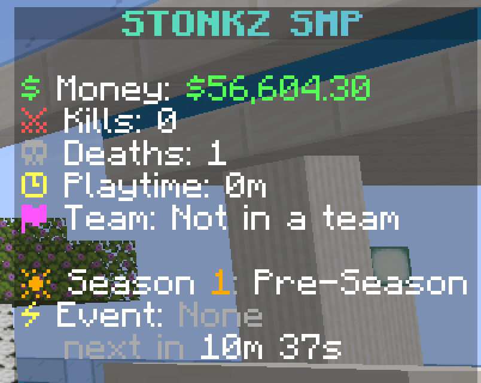

Out of the box, the scoreboard, tab list and `/menu` say **STONKZ SMP**, and the scoreboard footer says `play.yourserver.net`. The rebrand script swaps in your own name and address in one go.

## Rebrand on Windows

<Steps>
  <Step title="Run the script">
    Double-click `rebrand.bat`. It sits next to the `server` folder in the package. You can also copy `rebrand.bat` and `rebrand.ps1` into your server's root folder and run them there.
  </Step>
  <Step title="Type your name">
    Enter your server's name, for example `NEBULA SMP`. Press Enter to keep the current one.
  </Step>
  <Step title="Type your address">
    Enter your server's address, for example `play.nebula.gg`. A port such as `play.nebula.gg:25570` works too. Press Enter to keep the current one.
  </Step>
  <Step title="Apply it">
    If the server is already running, restart it, or run `/tab reload` and `/dm reload`.
  </Step>
</Steps>

It's easiest before you copy the `server` folder, but you can run it again any time. The script remembers your last name and address in `rebrand-current.txt`, next to the script, so the next run replaces those. If you move the scripts into your server's root folder after a rebrand, move `rebrand-current.txt` with them.

You can also run it from PowerShell with both values at once:

```powershell
.\rebrand.ps1 -Name "NEBULA SMP" -Address "play.nebula.gg"
```

### Name and address rules

- **Name:** up to 24 characters. Letters, numbers, spaces and `.` `!` `_` `-` only. Color codes, quotes and placeholders would break the configs, so the script refuses them.
- **Address:** up to 60 characters of letters, numbers, dots and dashes, with an optional `:port`.

### What it changes

| Where | File |
| --- | --- |
| Tab list header | `plugins/TAB/config.yml` |
| Scoreboard title | `plugins/TAB/config.yml` |
| Scoreboard footer (your address) | `plugins/TAB/config.yml` |
| `/menu` title | `plugins/DeluxeMenus/gui_menus/stonkz_menu.yml` |

The script checks every file before it writes anything. If you already edited one of these lines by hand, it stops and tells you which file to change yourself. Nothing is half renamed.

## Rebrand on Mac, Linux or a host panel

`rebrand.bat` needs Windows. Elsewhere, edit three spots by hand:

1. In `plugins/TAB/config.yml`, replace `STONKZ SMP` in both places: the tab header and the scoreboard title.
2. In the same file, replace `play.yourserver.net` at the bottom of the scoreboard.
3. In `plugins/DeluxeMenus/gui_menus/stonkz_menu.yml`, replace `STONKZ SMP` in `menu_title`.

Then restart, or run `/tab reload` and `/dm reload`.

## The scoreboard

<Frame>
  
</Frame>

The scoreboard lives in `plugins/TAB/config.yml` under `scoreboard.scoreboards.stonkz`. Each line uses a placeholder:

| Line | Placeholder |
| --- | --- |
| Money | `%vaultunlocked_eco_balance_formatted%` |
| Kills | `%seasonmanager_kills%` |
| Deaths | `%seasonmanager_deaths%` |
| Playtime | `%seasonmanager_playtime%` |
| Team | `%ultimateteams_team_name%` |
| Season | `%seasonmanager_number%` and `%seasonmanager_state%` |
| Event | `%condition:stonkz-event%` (shows **None** or **Live now**) |
| Next event in | `%worldevents_next_run%` |

The **Event** line uses a TAB condition named `stonkz-event`. It reads `%worldevents_active_plain%` and shows **● Live now** while any world event runs.

## The tab list

The tab list has a branded header with the tagline "Trade the market. Rule the server." The footer shows online count, ping and TPS, plus quick hints for `/menu`, `/shop`, `/ah` and `/rtp`. Players are sorted by rank. Edit it under `header-footer` in `plugins/TAB/config.yml`.

## The main menu

`/menu` opens a 45-slot menu from DeluxeMenus with buttons for the market, auction house, orders, portfolio, spawner vault, crates, world events, random teleport, homes, spawn, teams, bounties, season and leaderboards. The top shows the player's balance, team and season kills.

The market button shows live Diamond and Gold prices with trend arrows (`%stonkz_price_DIAMOND%`, `%stonkz_trend_DIAMOND%`). Edit it in `plugins/DeluxeMenus/gui_menus/stonkz_menu.yml`, then run `/dm reload`.

## Chat

Chat uses EssentialsX Chat with rank prefixes from LuckPerms. MVP and above can use color codes in chat.
