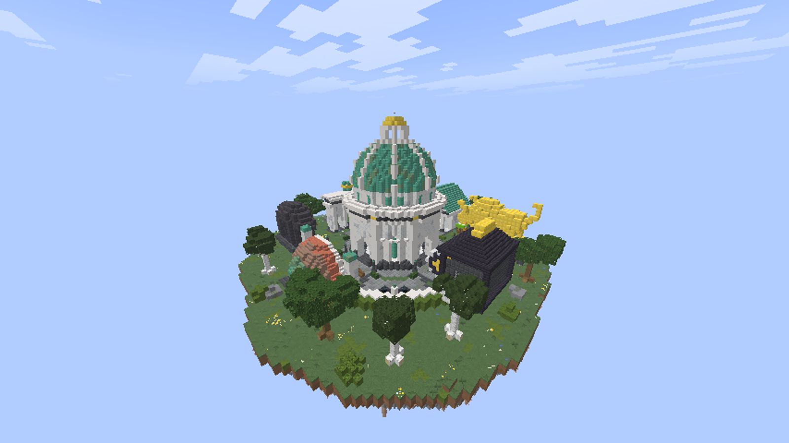
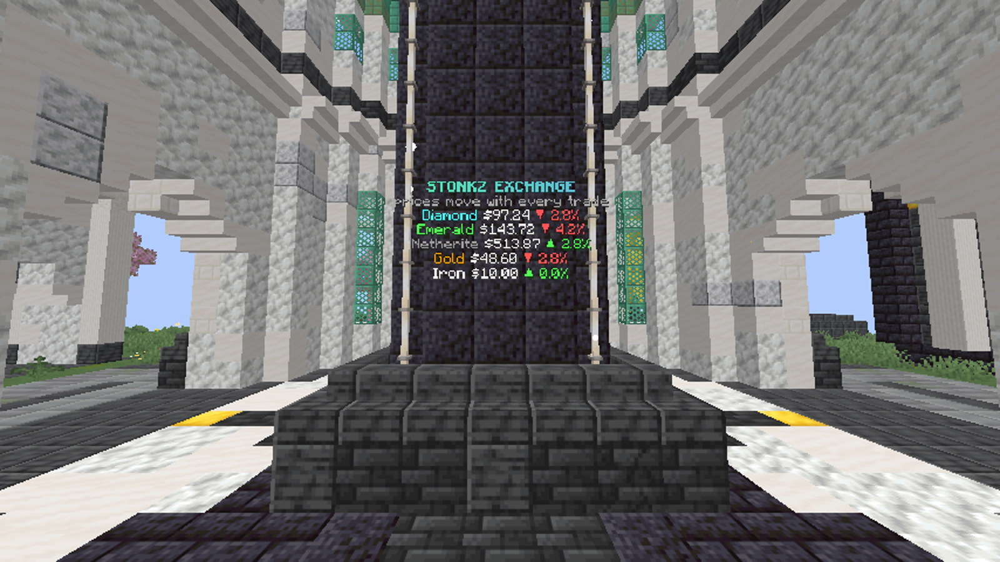

Spawn is the **Stonkz Exchange**: a floating island in its own void world, built around the market. New players land here on their first join with a set of stone tools, and `/spawn` brings anyone back.

<Frame>
  
</Frame>

## The price monolith

Under the copper dome stands a black monolith with four live price boards. Prices and trend arrows update while players watch.

| Board | Items |
| --- | --- |
| **Stonkz Exchange** | Diamond, Emerald, Netherite, Gold, Iron |
| **Mob Drops** | Blaze Rod, Ender Pearl, Gunpowder, Slime Ball, String |
| **Farms** | Wheat, Sugar Cane, Carrot, Potato, Melon |
| **Mining** | Obsidian, Amethyst, Quartz, Lapis, Redstone |

<Frame>
  
</Frame>

The boards are FancyHolograms holograms that read Stonkz placeholders such as `%stonkz_price_DIAMOND%` and `%stonkz_trend_DIAMOND%`. Edit them in `plugins/FancyHolograms/`.

## The four stations

Four avenues lead out from the dome. Each station has an NPC. Click it to open that feature.

| Station | NPC | Opens |
| --- | --- | --- |
| Market temple | **Market Broker** (villager) | The Stonkz market |
| Spawner Vault | **Spawner Vault** (iron golem) | The spawner shop |
| World Events stage | **World Events** (allay) | The list of live events |
| Wilderness gate | **Wilderness RTP** (wandering trader) | The `/rtp` picker |

The NPCs are FancyNpcs. Each one runs a player command on click, so they work with the same permissions as the commands.

## Crates

Common, Rare and Stonkz crates sit together with a hologram above them. Right-click a crate with a key to open it. See [Crates and AFK](/stonkz-smp/crates-and-afk).

## AFK Lounge

A cherry-blossom pergola pays players who idle there: $500 or a Common crate key every 5 minutes. See [Crates and AFK](/stonkz-smp/crates-and-afk).

## Protection

The whole spawn world is protected:

- no building or breaking
- no PvP and no damage of any kind
- no mob spawns
- no fire spread, TNT or explosions

World events never run in the spawn world. A small datapack catches anyone who falls off the island and puts them back at the spawn point.

## Moving or editing spawn

The spawn world is at `world/dimensions/minecraft/spawn` and is loaded by Multiverse-Core. To build there, give yourself the WorldGuard bypass or use the `admin` rank.

<Warning>
Keep the `spawn` folder when you reset the map for a new season. It is the Stonkz Exchange. See [Seasons](/stonkz-smp/seasons).
</Warning>
